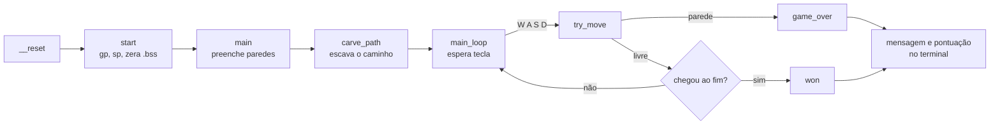

# Labirinto em Assembly RISC-V

**Jogo de labirinto escrito em Assembly RISC-V (RV32I), executado bare-metal no emulador Emulsiv, com o mapa desenhado numa tela de bitmap e controle pelo teclado.**

[](https://riscv.org/)
[](#como-funciona)
[](https://github.com/lecplacard/emulsiv)
[](../)

Trabalho da disciplina de Arquitetura de Computadores (UFMT). O programa roda sem sistema operacional: uma rotina de inicialização prepara a pilha e a memória, e o jogo conversa diretamente com os dispositivos do Emulsiv por E/S mapeada em memória (teclado, terminal e tela de bitmap).

> **Sobre o código-fonte:** o `jogo.s` original não tinha sido versionado. O arquivo atual foi reconstruído a partir do binário compilado e gera um `jogo.hex` idêntico, byte a byte, ao original. Os comentários foram escritos na reconstrução.

---

## Destaques

- **Bare-metal:** vetor de reset, zeragem da `.bss` e configuração de `gp` e `sp` feitas em Assembly, sem biblioteca C.
- **Mapa em bitmap 32 × 32:** cada byte da área de bitmap é um pixel; paredes, caminho e jogador têm cores diferentes.
- **Caminho em serpentina:** o labirinto é desenhado preenchendo tudo com parede e "escavando" segmentos horizontais e verticais.
- **Controle WASD** lido do teclado mapeado em memória.
- **Pontuação** igual ao número de movimentos, impressa em decimal no terminal ao fim da partida.

## Como funciona



1. **Inicialização** ([`startup.s`](startup.s)): o vetor de reset salta para `start`, que carrega `gp` e `sp` a partir dos símbolos do linker, zera a `.bss` e chama `main`. Interrupções caem em `irq_handler`, que só executa `mret`.
2. **Desenho:** `fill_walls` pinta os 1024 pixels de parede; `carve_path` chama `carve_segment` sete vezes para abrir um corredor em serpentina (linhas de 28 pixels ligadas por descidas de 6).
3. **Jogo:** `main_loop` aguarda o teclado sinalizar uma tecla e calcula a próxima posição (±1 na horizontal, ±32 na vertical). Em `try_move`, se o pixel de destino não for caminho, a partida termina; senão, o jogador avança e a pontuação aumenta.
4. **Fim:** ao alcançar a saída ou bater numa parede, `print_str` escreve "Voce Venceu!" ou "Game Over!" no terminal, seguido da pontuação em três dígitos.

### Mapa de memória

Definido em [`emulsiv.ld`](emulsiv.ld), para uma memória de 4 KB:

| Região | Endereços | Conteúdo |
|---|---|---|
| `.text`, `.data`, `.rodata`, `.bss` | `0x000` em diante | Vetores, código, mensagens e variáveis |
| `.stack` | `0xA00`–`0xBFF` (512 B) | Pilha, que cresce a partir de `__stack_pointer` |
| `.bitmap` | `0xC00`–`0xFFF` (1 KB) | Tela de 32 × 32 pixels, um byte por pixel |

### Dispositivos usados

| Dispositivo | Endereço | Uso |
|---|---|---|
| Teclado (status) | `0xB0000000` | Bit 6 ligado quando há tecla; o jogo zera o registrador após ler |
| Teclado (dado) | `0xB0000001` | Código ASCII da tecla (`w`, `a`, `s`, `d`) |
| Terminal | `0xC0000000` | Cada byte escrito vira um caractere na saída |

## Como compilar e executar

**Pré-requisitos:** toolchain `riscv64-unknown-elf` e o [Emulsiv](https://github.com/lecplacard/emulsiv).

```bash
sudo apt install gcc-riscv64-unknown-elf   # Debian/Ubuntu
brew install riscv-gnu-toolchain           # macOS (tap riscv-software-src/riscv)
```

```bash
make          # monta startup.s e jogo.s, liga com emulsiv.ld e gera jogo.hex
make dump     # mostra o código desmontado
make clean    # remove os arquivos gerados
```

Carregue o `jogo.hex` (formato Intel HEX) no Emulsiv, abra o teclado, o terminal e a tela de bitmap, e jogue com **W**, **A**, **S** e **D**.

## Estrutura do projeto

```text
labirinto-riscv/
├── jogo.s             # o jogo: desenho do labirinto, laço de teclado, movimento e pontuação
├── startup.s          # vetor de reset, tratador de interrupção e inicialização
├── emulsiv.ld         # linker script: memória de 4 KB, pilha e bitmap
├── Makefile           # montagem, ligação e geração do jogo.hex
└── layout.excalidraw  # mapa 32 × 32 com paredes, corredor, início e saída (abra em excalidraw.com)
```

No `jogo.s`, os registradores `sp`, `gp` e `tp` guardam as cores da parede, do jogador e do caminho. Isso só funciona porque o jogo não usa a pilha depois de iniciar; o cabeçalho do arquivo documenta o papel de cada registrador.

## Limitações

- O labirinto é fixo: o caminho é sempre o mesmo.
- Qualquer toque numa parede encerra a partida; não há vidas nem reinício sem recarregar o programa.
- Teclas diferentes de W, A, S e D são ignoradas.

---

[← Arquitetura de Computadores](../) · [Repositório principal](../../)
