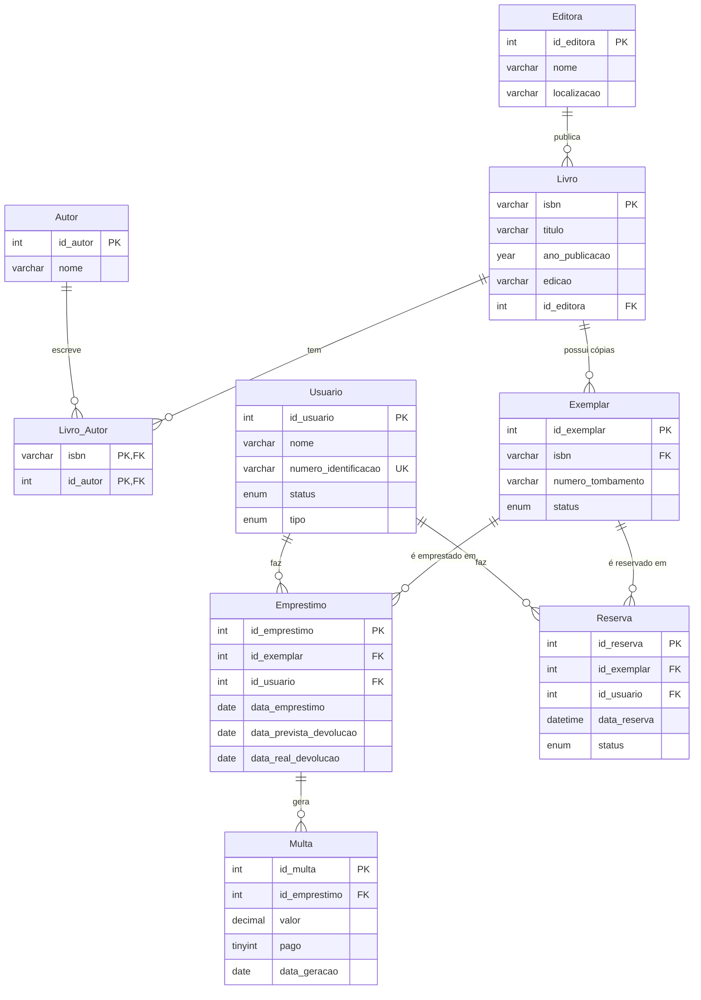

# Sistema de Gerenciamento de Biblioteca Digital

**Banco de dados relacional em MySQL para acervo, usuários, empréstimos, reservas com fila e multas, normalizado na 3FN e acompanhado de 10 consultas analíticas.**

[](https://www.mysql.com/)
[](#consultas-implementadas)
[](#normalização)
[](../)

Projeto da disciplina de Banco de Dados (UFMT, 2025/2), feito por **Raissa Caroline Cavalcanti da Silva** e **Gabriel Nunes**. O esquema cobre o ciclo completo de uma biblioteca: cadastro do acervo físico por exemplar, controle de usuários, empréstimos com prazo, fila de reservas por ordem de chegada e registro de multas por atraso.

---

## Sumário

- [Destaques](#destaques)
- [Modelo de dados](#modelo-de-dados)
- [Como executar](#como-executar)
- [Consultas implementadas](#consultas-implementadas)
- [Resultados obtidos](#resultados-obtidos)
- [Regras de negócio](#regras-de-negócio)
- [Normalização](#normalização)
- [Estrutura do projeto](#estrutura-do-projeto)

---

## Destaques

- **9 tabelas na 3FN**, com relacionamento N:M entre livros e autores e controle no nível do exemplar físico.
- **Integridade no próprio banco:** chaves estrangeiras com `ON DELETE RESTRICT`, `CHECK` de datas e valores, `ENUM` para status e `UNIQUE` na identificação do usuário.
- **Fila de reservas FIFO** ordenada pela data da reserva.
- **10 consultas analíticas**, incluindo uma `VIEW`, a tradução de uma expressão de álgebra relacional e duas formas de responder a mesma pergunta (`NOT IN` e `NOT EXISTS`).
- **8 índices** nas colunas usadas em junções e filtros.
- **Resultados exportados em CSV** e relatório em PDF explicando o código.

## Modelo de dados



| Tabela | Descrição |
|---|---|
| `Editora` | Editoras do acervo |
| `Livro` | Títulos, identificados pelo ISBN |
| `Autor` / `Livro_Autor` | Autores e a associação N:M com os livros |
| `Exemplar` | Cada cópia física de um título, com tombamento e status (`Disponivel`, `Emprestado`, `Reservado`, `Extraviado`) |
| `Usuario` | Alunos e professores |
| `Emprestimo` | Retiradas e devoluções; `data_real_devolucao` nula indica empréstimo em aberto |
| `Reserva` | Fila de espera, com status `Ativa`, `Cancelada` ou `Atendida` |
| `Multa` | Penalidades por atraso, pagas ou pendentes |

O DER e o esquema lógico também estão em [`DER_v2.html`](DER_v2.html) e [`Esquema_Logico.html`](Esquema_Logico.html); abra no navegador.

## Como executar

**Pré-requisitos:** MySQL 8.0+ (o esquema usa `CHECK` e `DEFAULT (CURRENT_DATE)`, que exigem essa versão) e, opcionalmente, o MySQL Workbench.

```bash
# macOS (Homebrew)
brew install mysql
brew services start mysql
```

Execute os scripts nesta ordem:

```bash
mysql -u root -p < DDL.sql         # cria o banco biblioteca_digital, tabelas e índices
mysql -u root -p < DML.sql         # insere os dados de teste
mysql -u root -p < Consultas.sql   # executa as consultas RC001 a RC010
```

No MySQL Workbench, abra cada arquivo e execute com `Cmd + Shift + Enter` (arquivo inteiro) ou `Cmd + Enter` (uma consulta por vez).

**Verificação rápida:**

```sql
USE biblioteca_digital;
SELECT COUNT(*) FROM Livro;       -- 10
SELECT COUNT(*) FROM Usuario;     -- 10
SELECT COUNT(*) FROM Exemplar;    -- 17
SELECT COUNT(*) FROM Emprestimo;  -- 13
```

## Consultas implementadas

| ID | Consulta | O que responde |
|---|---|---|
| RC001 | Livros em atraso | Usuário, título e dias de atraso dos empréstimos vencidos |
| RC002 | Análise de acervo | Editoras ordenadas pelo número de títulos |
| RC003 | Disponibilidade | Títulos sem nenhum exemplar emprestado (versões com `NOT IN` e `NOT EXISTS`) |
| RC004 | Transações por usuário | Histórico de um usuário com o status de cada empréstimo (parametrizada) |
| RC005 | View de empréstimos ativos | `CREATE VIEW V_EmprestimosAtivos`, com a coluna calculada `situacao` |
| RC006 | Álgebra relacional | Tradução de `π Nome, Titulo (σ Ano > 2020 (Usuário ⋈ Empréstimo ⋈ Livro))` |
| RC007 | Ranking de livros | Títulos mais emprestados nos últimos 6 meses |
| RC008 | Inadimplência | Total de multas por usuário, pagas e pendentes |
| RC009 | Reservas pendentes | Títulos com fila ativa e quantas pessoas aguardam |
| RC010 | Próximo da fila | Primeiro usuário da fila FIFO para um ISBN |

## Resultados obtidos

Os resultados estão em `resultados_1.csv` a `resultados_11.csv`. Os dias de atraso dependem da data em que as consultas foram executadas.

| Consulta | Resultado |
|---|---|
| RC001 | 6 empréstimos vencidos; o maior atraso é de 434 dias (*MySQL: Guia do Desenvolvedor*) |
| RC002 | O'Reilly Media e Bookman lideram com 2 títulos cada; as outras 6 editoras têm 1 |
| RC003 | 7 títulos com exemplar disponível, como *Introduction to Algorithms* (4ª ed.) |
| RC005 | 6 empréstimos ativos, todos em atraso nos dados de teste |
| RC006 | 4 pares usuário–livro com publicação posterior a 2020 |
| RC008 | R$ 190,00 em multas pendentes; o maior devedor acumula R$ 72,00 |
| RC009 | 3 títulos com fila; *Sistemas de Banco de Dados* tem 2 pessoas aguardando |
| RC010 | Para o ISBN `978-8543004792`, a primeira da fila é a reserva de 20/01/2025, às 09:00 |

## Regras de negócio

| ID | Regra | Implementação |
|---|---|---|
| RN001 | ISBN único por livro; identificação única por usuário | `PRIMARY KEY (isbn)`, `UNIQUE (numero_identificacao)` |
| RN002 | Integridade referencial | `FOREIGN KEY` com `ON DELETE RESTRICT` |
| RN003 | Campos obrigatórios | `NOT NULL` em título, nomes e identificação |
| RN004 | Livro–Autor N:M | Tabela `Livro_Autor` com chave composta |
| RN005 | Terceira forma normal | Sem dependências transitivas |
| RN006 | Devolução prevista posterior ao empréstimo | `CHECK (data_prevista_devolucao > data_emprestimo)` |
| RN101 | Reserva com status | `ENUM('Ativa', 'Cancelada', 'Atendida')` |
| RN102 | Fila FIFO | `ORDER BY data_reserva ASC` nas consultas |
| RN103 | Controle por exemplar | Empréstimos e reservas apontam para `Exemplar` |

## Normalização

- **1FN:** todos os atributos são atômicos; o N:M entre Livro e Autor foi decomposto em `Livro_Autor`.
- **2FN:** todo atributo não chave depende da chave primária inteira. `Livro_Autor` não tem atributos não chave.
- **3FN:** não há dependências transitivas. A localização da editora fica em `Editora`, e não em `Livro`; status e tipo do usuário dependem só de `id_usuario`.

## Estrutura do projeto

```text
Gerenciamento-de-biblioteca/
├── DDL.sql                # criação do banco, tabelas, restrições e índices
├── DML.sql                # dados de teste
├── Consultas.sql          # consultas RC001 a RC010
├── DER_v2.html            # diagrama entidade-relacionamento
├── Esquema_Logico.html    # esquema relacional lógico
├── resultados_*.csv       # resultados exportados das consultas
└── relatório-código.pdf   # explicação do DDL, do DML e das consultas
```

## Limitações

- As multas são inseridas pelo `DML.sql`; não há gatilho que as gere automaticamente ao registrar uma devolução atrasada.
- O status do exemplar não é atualizado automaticamente por empréstimos e devoluções: ele é mantido pelos dados de teste.

---

[← Banco de Dados](../) · [Repositório principal](../../)
