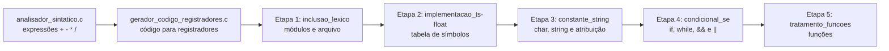

# Compiladores

**Construção incremental de um compilador para um C simplificado: da análise de expressões aritméticas a um compilador com tipos, controle de fluxo e funções, que gera assembly x86-64 para Linux, macOS e Windows.**

[](https://gcc.gnu.org/)
[](https://www.nasm.us/)
[](#como-compilar)
[](../)

Trabalhos da disciplina de Compiladores do curso de Ciência da Computação da UFMT (prof. Ivairton M. Santos). A disciplina é conduzida em ciclos: a cada ciclo, o processo completo de análise léxica, sintática e geração de código é revisitado com novos elementos. Por isso, as pastas deste diretório são **versões sucessivas de um mesmo compilador**, e não módulos isolados.

---

## Evolução do compilador



| Etapa | Pasta | O que acrescenta |
|---|---|---|
| 1 | [inclusao_lexico](./inclusao_lexico) | Compilador modularizado (léxico, sintático, gerador e `main`), leitura do código-fonte de arquivo, precedência de `*` e `/`, mensagens de erro léxico e sintático |
| 2 | [implementacao_ts-float](./implementacao_ts-float) | Tabela de símbolos, declarações `int` e `float`, números de ponto flutuante no léxico e `section .data` em NASM |
| 3 | [constante_string_novos_tipos_dados](./constante_string_novos_tipos_dados) | Tipos `char` e `string`, atribuição de constantes com verificação de declaração e de tipo, código x86-64 da atribuição |
| 4 | [condicional_se](./condicional_se) | `if`/`else` e `while`, expressões booleanas com `&&` e `||` em curto-circuito, expressões `int`/`float`/`char`, `read`/`write` com conversão e geração para três plataformas |
| 5 | [tratamento_funcoes](./tratamento_funcoes) | Funções: protótipos na tabela de símbolos de funções, chamadas verificadas contra o protótipo e implementação com `jal`/`jr` |

### Programas avulsos

| Arquivo | Descrição |
|---|---|
| [analisador_sintatico.c](analisador_sintatico.c) | Analisador sintático descendente recursivo para expressões com `+`, `-`, `*` e `/`, com precedência e detecção de erros de sintaxe |
| [gerador_codigo_registradores.c](gerador_codigo_registradores.c) | Evolução do anterior que gera código para uma máquina com registradores (`LOAD`, `ADD`, `SUB`, `MUL`, `DIV`) no arquivo `codigo.asm` |
| [analisador_tas.c](analisador_tas.c) | Analisador sintático preditivo dirigido por tabela (TAS) para expressões com soma e multiplicação, que imprime a tabela e o traço de execução |

Exemplo do gerador para registradores com a entrada `2+3*4`:

```text
LOAD R0, 2
LOAD R1, 3
LOAD R2, 4
MUL R1, R1, R2
ADD R0, R0, R1
```

## Como compilar

Os programas avulsos leem a expressão da entrada padrão (só dígitos e operadores, sem espaços):

```bash
gcc -o analisador_tas analisador_tas.c
echo '2+3*4' | ./analisador_tas
```

Cada etapa do compilador tem o próprio `makefile` e instruções no README da pasta. Para gerar e executar o assembly é preciso ter o [NASM](https://www.nasm.us/) instalado.

## Conteúdo da disciplina

1. Estrutura geral de um compilador e de um interpretador
2. Análise léxica com autômatos finitos
3. Tabelas de símbolos e escopos
4. Análise léxica codificada e geradores de analisadores léxicos
5. Análise sintática preditiva recursiva descendente e dirigida por tabela
6. Construção de tabela de análise sintática
7. Árvores de sintaxe abstrata
8. Análise sintática ascendente e geradores de analisadores sintáticos
9. Geração de código intermediário

As técnicas de análise léxica e sintática também são usadas fora dos compiladores, em expressões regulares, planilhas, bancos de dados e processamento de linguagem.

---

[← Repositório principal](../)
