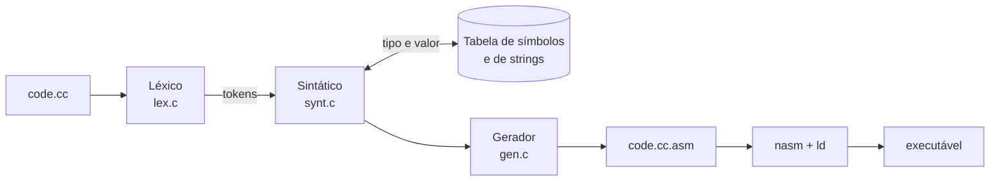

# Constantes `string`, novos tipos (`char` e `string`) e atribuição

**Terceira etapa do compilador: tipos `char` e `string`, comando de atribuição de constantes com verificação de tipo e geração do código x86-64 correspondente.**

[](https://gcc.gnu.org/)
[](makefile)
[](https://www.nasm.us/)
[](../)

Evolução do compilador de C simplificado da disciplina de Compiladores (UFMT). Para cada atribuição, o compilador verifica se a variável foi declarada e se a constante é compatível com o tipo, guarda o valor na tabela de símbolos e gera o código assembly (NASM, x86-64).

Etapa 3 de 5 · anterior: [tabela de símbolos e `float`](../implementacao_ts-float) · próxima: [`if`, `while` e operadores lógicos](../condicional_se)

---

## Sumário

- [Destaques](#destaques)
- [Como funciona](#como-funciona)
- [Gramática](#gramática)
- [Compatibilidade de tipos na atribuição](#compatibilidade-de-tipos-na-atribuição)
- [Estrutura do projeto](#estrutura-do-projeto)
- [Como compilar e executar](#como-compilar-e-executar)
- [Alterações em relação à base](#alterações-em-relação-à-base)

---

## Destaques

- **Quatro tipos:** `int`, `float`, `char` e `string`, cada um com regras próprias de compatibilidade.
- **Verificação semântica** de declaração, tipo e faixa de valores (`int` até 2147483647).
- **`float` em IEEE 754:** a constante vira o padrão de bits de precisão simples no `mov`.
- **Strings** na tabela de strings, reaproveitadas se repetidas e copiadas com `rep movsb`.
- **10 casos de erro tratados** com mensagens claras; nenhum `.asm` incompleto em caso de falha.

## Como funciona



## Gramática

```
program      -> declarations statements
declarations -> declaration declarations | ε
declaration  -> type id ;
type         -> int | float | char | string
statements   -> statement statements | ε
statement    -> id = constant ;
constant     -> num | float_num | char_const | string_const
```

## Compatibilidade de tipos na atribuição

| Variável | Constantes aceitas | Exemplo |
|---|---|---|
| `int` | inteira, até `2147483647` | `x = 42;` |
| `float` | float ou inteira (convertida para float) | `z = 3.14;` / `z = 10;` |
| `char` | um caractere entre aspas simples | `c = 'a';` |
| `string` | texto entre aspas duplas, até 29 caracteres | `nome = "Maria";` |

Qualquer outra combinação é erro (por exemplo, `int` recebendo `3.14`, já que haveria perda da parte fracionária).

## Estrutura do projeto

| Arquivo | Descrição |
|---|---|
| [struct_compiler.h](struct_compiler.h) | Constantes globais, códigos dos tokens e a estrutura `type_token`. As constantes ganharam tags próprias (`NUM`, `FLOAT_NUM`, `CHAR_CONST`, `STRING_CONST`), separadas das palavras reservadas de tipo (`INT`, `FLOAT`, `CHAR`, `STRING`). |
| [lex.h](lex.h) / [lex.c](lex.c) | Analisador léxico. Reconhece números inteiros e float (`3.14`), constantes char (`'a'`) e string (`"Maria"`), identificadores, palavras reservadas (incluindo `char` e `string`), operadores, `=` e `;`. |
| [symbols.h](symbols.h) / [symbols.c](symbols.c) | Tabela de símbolos de variáveis (nome, tipo, endereço e um `value` genérico do tipo `void*`) e tabela de strings (rótulos `str0`, `str1`, ...). `sym_set_value` converte o lexema da constante conforme o tipo da variável e guarda o valor. |
| [synt.h](synt.h) / [synt.c](synt.c) | Analisador sintático descendente recursivo e `main`. Processa declarações e atribuições, verifica declaração e compatibilidade de tipos, imprime as tabelas de símbolos e grava `<entrada>.asm`. |
| [gen.h](gen.h) / [gen.c](gen.c) | Gerador de código. `gen_assign` gera a atribuição a partir do valor guardado na TS, e `gen_data_section` reserva espaço para cada variável e emite as constantes string. |
| [code.cc](code.cc) | Programa de exemplo com declarações e atribuições de todos os tipos. |
| [makefile](makefile) | Compilação do compilador (`make`) e limpeza (`make clean`). |
| [tst_lex.c](tst_lex.c) | Teste isolado do léxico: imprime a tag, o nome da tag e o lexema de cada token do arquivo, e para no primeiro erro léxico (`make tstLex`, depois `./tstLexCompiler arquivo`) |

## Como compilar e executar

```bash
make                    # ou: gcc -Wall -o compiler lex.c symbols.c gen.c synt.c
./compiler code.cc      # gera code.cc.asm

make tstLex             # teste isolado do léxico
./tstLexCompiler code.cc

# montagem e ligação do código gerado (Linux x86-64)
nasm -f elf64 code.cc.asm
ld -m elf_x86_64 code.cc.o -o programa
```

### Exemplo

Entrada ([code.cc](code.cc)):

```c
int x;
int y;
float z;
string nome;
char letra;
float w;

x = 1;
y = 2;
z = 3.14;
nome = "Maria";
letra = 'a';
w = 10;
x = 42;
```

Código gerado para as atribuições (trecho de `code.cc.asm`):

```nasm
;z = 3.14
mov dword [z], 0x4048F5C3

;nome = "Maria"
mov rsi, str0
mov rdi, nome
mov rcx, 6
cld
rep movsb

;letra = 'a'
mov byte [letra], 97
```

- `int`: `mov dword` com o valor.
- `float`: `mov dword` com o padrão de bits IEEE 754 (precisão simples) do valor guardado na TS.
- `char`: `mov byte` com o código do caractere.
- `string`: a constante vai para a tabela de strings (`str0: db "Maria", 0`, reaproveitada se repetida) e é copiada com o `\0` para a variável com `rep movsb`.

Seção de dados gerada:

```nasm
	section .data
x: dd 0
y: dd 0
z: dd 0.0
nome: times 32 db 0
letra: db 0
w: dd 0.0
str0: db "Maria", 0
```

A tabela de símbolos impressa ao final mostra o valor guardado de cada variável (`x` = `42`, já que a última atribuição substitui a anterior).

### Casos de erro tratados

| Entrada | Mensagem |
|---|---|
| `int x; y = 1;` | `[ERRO] Variavel 'y' nao declarada.` |
| `int x; x = 3.14;` | `[ERRO] Tipo incompativel: variavel 'x' (int) nao pode receber a constante 3.14 (float).` |
| `char c; c = "a";` | `[ERRO] Tipo incompativel: variavel 'c' (char) nao pode receber a constante "a" (string).` |
| `int x; x = 3000000000;` | `[ERRO] Constante 3000000000 fora do intervalo de int (maximo 2147483647).` |
| `int x; x = y;` | `[ERRO] Constante esperada na atribuicao a 'x', encontrado 'y'.` |
| `int x; x 1;` | `[ERRO] Entrada inesperada: '1'. Esperado: '='.` |
| `int x; x = 1` (sem `;`) | `[ERRO] Fim de arquivo inesperado. Esperado: ';'.` |
| `char c; c = 'ab';` | `[ERRO LEXICO] Constante char mal formada: deve ter exatamente um caractere entre aspas simples.` |
| `s = "abc;` | `[ERRO LEXICO] String nao fechada: "abc;` |
| `int x; x = 1; int y;` | `[ERRO] Comando desconhecido: 'int'.` (declarações vêm antes dos comandos) |

Em caso de erro, o programa imprime `FALHA NA COMPILACAO DO PROGRAMA`, não deixa o `.asm` incompleto e termina com código de saída `1`.

## Alterações em relação à base

Além da atribuição, foram corrigidos problemas da base que afetavam diretamente esta etapa:

| Problema | Arquivo | Correção |
|---|---|---|
| A constante `"Maria"` e a palavra reservada `string` recebiam a mesma tag (`STRING`), e números float recebiam a tag `NUM` | [lex.c](lex.c), [struct_compiler.h](struct_compiler.h) | Tags próprias para constantes: `FLOAT_NUM`, `CHAR_CONST`, `STRING_CONST` |
| O laço de strings sobrescrevia o último caractere com a aspa de fechamento (`"Maria"` virava `"Mari"`) e não detectava string sem fechamento | [lex.c](lex.c) | Aspa de fechamento adicionada no fim; erro léxico para string não fechada ou longa demais |
| `keyWordFind` lia além do fim de `key_words` (vetor sem sentinela) | [lex.c](lex.c) | Sentinela `{0, "", 0}` |
| Lexemas com mais de 31 caracteres estouravam `buffer[MAX_CHAR]`; `ch` como `char` não detectava `EOF` onde `char` não tem sinal | [lex.c](lex.c) | Escrita limitada ao buffer (erro léxico); `ch` passou a ser `int`; `\r` tratado como espaço |
| `sym_declare` retornava a entrada seguinte à declarada | [symbols.c](symbols.c) | Retorna a entrada recém-declarada |
| A primeira atribuição após as declarações (`x = 1;`) gerava `[ERRO] Tipo desconhecido`, pois `ID` não encerrava as declarações | [synt.c](synt.c) | `ID` encerra as declarações |
| `int 5;` declarava a variável `5` | [synt.c](synt.c) | Verifica se há um identificador após o tipo |
| A seção de dados gravava strings de formato no lugar das variáveis (`x: dd "%d", 4`) e reservava só 16 bytes para `string` | [gen.c](gen.c) | Espaço do tamanho de cada tipo, iniciado com zero (`dd 0`, `dd 0.0`, `db 0`, `times 32 db 0`); constantes string terminadas em `\0` |
| `output_file_name[32]` estourava com caminhos longos; `fopen` da saída não era verificado; `main` retornava `1` mesmo com sucesso | [gen.c](gen.c), [synt.c](synt.c) | `FILENAME_MAX` com `snprintf`, verificação do `fopen` e código de saída `0`/`1` |
| Tokens consumidos nunca eram liberados | [synt.c](synt.c) | `free` do token anterior em `match` |

O código compila sem avisos com `gcc -Wall -Wextra` e roda sem erros com `-fsanitize=address,undefined` no exemplo e nos casos de erro acima.

### Limitações (próximas etapas)

- Apenas constantes podem ser atribuídas: não há expressões nem atribuição entre variáveis (`x = y;`), e números negativos (`x = -1;`) ainda não são aceitos.
- Constantes char não aceitam sequências de escape (`'\n'`), e strings estão limitadas a 29 caracteres pelo tamanho do lexema (`MAX_CHAR`).
- Os nomes das variáveis viram rótulos no assembly sem prefixo, então uma variável chamada `str0`, `main` ou com nome de registrador (`rax`) conflita com o NASM.
- As funções `genAdd`/`genSub`/`genMult`/`genDiv`/`genNum` ainda não são usadas, e `genMult`/`genDiv` mantêm as instruções inválidas da base (`imult`, `idiv rax,rbx`).

---

Etapa 3 de 5 · anterior: [tabela de símbolos e `float`](../implementacao_ts-float) · próxima: [`if`, `while` e operadores lógicos](../condicional_se)

[← Compiladores](../) · [Repositório principal](../../)
