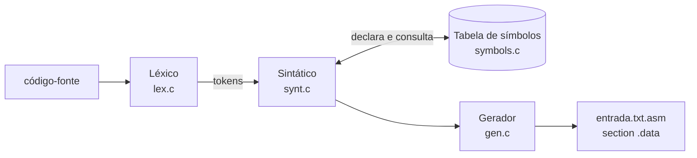

# Tabela de símbolos e números `float`

**Segunda etapa do compilador: declarações de variáveis `int` e `float`, tabela de símbolos e geração da seção de dados em NASM.**

[](https://gcc.gnu.org/)
[](https://www.nasm.us/)
[](../)

Evolução do compilador de C simplificado da disciplina de Compiladores (UFMT). Nesta etapa o compilador processa apenas **declarações de variáveis**: registra cada uma na tabela de símbolos, reconhece números de ponto flutuante no léxico e gera a `section .data` do programa em assembly NASM.

Etapa 2 de 5 · anterior: [expressões e leitura de arquivo](../inclusao_lexico) · próxima: [`char`, `string` e atribuição](../constante_string_novos_tipos_dados)

---

## Sumário

- [Destaques](#destaques)
- [Como funciona](#como-funciona)
- [Gramática](#gramática)
- [Estrutura do projeto](#estrutura-do-projeto)
- [Como compilar e executar](#como-compilar-e-executar)
- [Análise do código e correções](#análise-do-código-e-correções)

---

## Destaques

- **Tabela de símbolos** de variáveis (nome, tipo, endereço e valor genérico) e tabela de strings com rótulos `str0`, `str1`, ...
- **Léxico de números** que distingue inteiros de `float` e trata casos de borda como `7.`, `10.x` e `1.2.3`.
- **Detecção de redeclaração** e de erros de sintaxe nas declarações.
- **Seção de dados NASM** com `dd 0` ou `dd 0.0` conforme o tipo.
- **Código revisado com AddressSanitizer:** 12 problemas da base corrigidos; compila sem avisos com `-Wall -Wextra`.

## Como funciona



## Gramática

```
program      -> declarations statements
declarations -> declaration declarations | ε
declaration  -> tipo id ;
tipo         -> int | float
statement    -> ε
```

`statements` ainda não é processado: `program()` chama apenas `declarations()`.

## Estrutura do projeto

| Arquivo | Descrição |
|---|---|
| [struct_compiler.h](struct_compiler.h) | Constantes globais, códigos dos tokens (incluindo `FLOAT_NUM` e as palavras reservadas `INT`/`FLOAT`) e a estrutura `type_token`. |
| [lex.h](lex.h) / [lex.c](lex.c) | Analisador léxico. Reconhece inteiros (`42`) e números com precisão (`3.14`): um ponto só faz parte do número se for seguido de dígito (`7.` gera `NUM` seguido de um token de erro para o `.`). Também reconhece identificadores, palavras reservadas, operadores, parênteses e `;`. |
| [symbols.h](symbols.h) / [symbols.c](symbols.c) | Tabela de símbolos de variáveis (nome, tipo, endereço e um `value` genérico do tipo `void*`, convertido conforme o tipo) e tabela de strings (rótulos `str0`, `str1`, ...). Inclui funções de busca, declaração, inicialização e impressão para depuração. O suporte a funções está esboçado em comentários. |
| [synt.h](synt.h) / [synt.c](synt.c) | Analisador sintático descendente recursivo e `main`. Valida as declarações, detecta variável redeclarada e erros de sintaxe (falta de identificador ou de `;`), imprime a tabela de símbolos e grava o arquivo `<entrada>.asm`. |
| [gen.h](gen.h) / [gen.c](gen.c) | Gerador de código. `gen_data_section()` emite a `section .data` com as strings de formato e uma entrada `dd` por variável (`dd 0` para `int`, `dd 0.0` para `float`). As funções `genAdd`, `genSub`, `genMult`, `genDiv` e `genNum` (pilha com `rax`/`rbx`) ainda não são usadas nesta etapa. |
| [tst_lex_numeros.c](tst_lex_numeros.c) | Programa de teste do léxico: lê `entrada_numeros.txt` (ou o arquivo passado como argumento) e imprime se cada token é `NUM` ou `FLOAT_NUM`. |
| [entrada_numeros.txt](entrada_numeros.txt) | Entrada de exemplo para o teste do léxico, com inteiros, floats e casos de borda (`7.`, `10.x`, `1.2.3` e um número com mais de 31 dígitos). |

## Como compilar e executar

```bash
# compilador
gcc -Wall -o compiler lex.c symbols.c gen.c synt.c
./compiler entrada.txt          # gera entrada.txt.asm

# teste do léxico de números (usa entrada_numeros.txt por padrão)
gcc -Wall -o tst_lex_numeros tst_lex_numeros.c lex.c
./tst_lex_numeros [arquivo]
```

### Exemplo

Entrada (`entrada.txt`):

```c
int x;
float y;
int z;
```

Saída gerada (`entrada.txt.asm`):

```nasm
section .data
fmtstr0  db  "%d",0
fmtstr1  db  "%s",0
x  dd  0
y  dd  0.0
z  dd  0
```

Casos de erro tratados:

- `int x; int x;` → `[ERRO] Variavel 'x' ja declarada.`
- `int x float y;` → `[ERRO] Entrada processada: 'float' - tag esperada: '59'` (faltou `;`)

Em ambos os casos o programa termina com `FALHA NA COMPILACAO DO PROGRAMA` e código de saída `1`.

## Análise do código e correções

A primeira versão compilava sem avisos e tratava corretamente os casos acima, mas os testes manuais e o AddressSanitizer revelaram os problemas abaixo, já corrigidos:

| Problema | Arquivo | Correção |
|---|---|---|
| `keyWordFind` lia além do fim de `key_words`, pois o vetor não tinha entrada sentinela (o AddressSanitizer acusava `global-buffer-overflow` em `int abc;`) | [lex.c](lex.c) | Sentinela `{0, "", 0}` no fim do vetor |
| Identificadores ou números com mais de 31 caracteres estouravam `buffer[MAX_CHAR]` e abortavam o programa | [lex.c](lex.c) | Escrita limitada ao tamanho do buffer; lexema longo demais vira erro léxico com mensagem |
| `ch` declarado como `char`: onde `char` não tem sinal (ex.: Linux em ARM), `EOF` nunca era detectado | [lex.c](lex.c) | `ch` passou a ser `int` |
| No caso `7.`, eram feitos dois `ungetc` seguidos, mas o padrão C só garante um | [lex.c](lex.c) | Pilha própria de caracteres devolvidos (`nextChar`/`backChar`) |
| Arquivos com quebra de linha CRLF (Windows) geravam erro | [lex.c](lex.c) | `\r` passa a ser tratado como espaço |
| Token de erro tinha lexema vazio, o que tornava a mensagem inútil | [lex.c](lex.c) | O lexema guarda o caractere inválido |
| A palavra `integer` era mapeada para `NUM` (tag de literal inteiro) | [lex.c](lex.c) | Mapeada para `INT`, como sinônimo de `int` |
| `output_file_name[32]` estourava com caminhos longos, e o `fopen` da saída não era verificado | [gen.c](gen.c), [synt.c](synt.c) | Vetor com `FILENAME_MAX`, `snprintf` e verificação do `fopen` |
| Tokens consumidos nunca eram liberados | [synt.c](synt.c) | `free` do token anterior em `match` |
| `genMult` emitia `imult` (instrução inexistente), e `genDiv` usava `idiv rax,rbx` (`idiv` aceita um único operando) | [gen.c](gen.c) | `imul rax,rbx`; `cqo` seguido de `idiv rbx` |
| Cópia de string sem limite em `sym_string_declare`, `sprintf` em vez de `snprintf`, e inicialização percorrendo 4096 posições quando só 64 são usadas | [symbols.c](symbols.c) | `strncpy`/`snprintf` com limite; laço até `MAX_STRINGS` |
| `tst_lex_numeros.c` dependia de `entrada_numeros.txt`, que não existia | [tst_lex_numeros.c](tst_lex_numeros.c) | Arquivo de exemplo adicionado; o teste aceita outro arquivo como argumento e libera os tokens |

Depois das correções, o código compila sem avisos com `gcc -Wall -Wextra` e roda sem erros com `-fsanitize=address,undefined`.

### Limitações que permanecem (próximas etapas)

- O valor de um `FLOAT_NUM` fica só no `lexema`: o campo `value` do token é `int`.
- `statements()` ainda não é chamado, e as funções `genAdd`/`genSub`/`genMult`/`genDiv`/`genNum` ainda não são usadas.

---

Etapa 2 de 5 · anterior: [expressões e leitura de arquivo](../inclusao_lexico) · próxima: [`char`, `string` e atribuição](../constante_string_novos_tipos_dados)

[← Compiladores](../) · [Repositório principal](../../)
