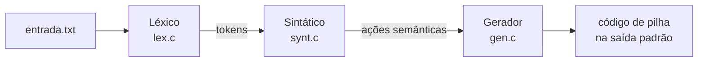

# Compilador de expressões: multiplicação, divisão e leitura de arquivo

**Primeira etapa do compilador da disciplina: expressões aritméticas com as quatro operações e precedência correta, lidas de um arquivo e traduzidas para código de pilha x86-64.**

[](https://gcc.gnu.org/)
[](makefile)
[](../)

Trabalho de **Raissa Caroline Cavalcanti da Silva** na disciplina de Compiladores (UFMT, prof. Ivairton M. Santos). A partir do código-base apresentado em sala, este ciclo amplia o léxico e o sintático para multiplicação e divisão, lê o código-fonte de um arquivo, separa o `main` em módulo próprio e adiciona mensagens de erro léxico e sintático.

Etapa 1 de 5 · próxima: [tabela de símbolos e `float`](../implementacao_ts-float)

---

## Sumário

- [Destaques](#destaques)
- [Como funciona](#como-funciona)
- [O que foi alterado em relação ao código-base](#o-que-foi-alterado-em-relação-ao-código-base)
- [Gramática reconhecida](#gramática-reconhecida)
- [Estrutura do projeto](#estrutura-do-projeto)
- [Como compilar e executar](#como-compilar-e-executar)
- [Tratamento de erros](#tratamento-de-erros)

---

## Destaques

- **Precedência correta** de `*` e `/` sobre `+` e `-`, garantida pela gramática.
- **Analisador sintático descendente recursivo**, uma função por não terminal.
- **Geração de código de pilha** (`push`, `pop`, `add`, `sub`, `imul`, `idiv`) durante a análise.
- **Erros com posição:** caractere inválido (léxico) e token inesperado (sintático).
- **Módulos separados:** léxico, sintático, gerador e `main`, com um programa de teste só para o léxico.

## Como funciona



O sintático pede um token por vez ao léxico e, a cada regra reconhecida, chama o gerador. Ao fim, informa se a cadeia pertence à linguagem.

## O que foi alterado em relação ao código-base

1. **Entrada via arquivo:** `initLex` (em [lex.c](lex.c)) deixou de usar `gets()` interativo e passou a receber o caminho de um arquivo (`initLex(char *filename)`), carregando todo o seu conteúdo para análise.
2. **Multiplicação e divisão com precedência:** o léxico reconhece os novos tokens `*` (`TIMES`) e `/` (`DIVIDE`) ([struct_compiler.h](struct_compiler.h), [lex.c](lex.c)); a gramática do sintático foi reescrita para dar precedência a esses operadores sobre `+`/`-` (ver seção [Gramática reconhecida](#gramática-reconhecida)); o gerador de código ganhou `genMul`/`genDiv` ([gen.c](gen.c)).
3. **`main` isolado:** a função principal foi retirada de `synt.c` e movida para [main.c](main.c), que agora recebe o arquivo de entrada como argumento de linha de comando.
4. **Mensagens de erro:** o léxico reporta caractere inválido e posição na entrada (erro léxico); o sintático reporta, em `match()` e no tratamento de token inesperado, o que era esperado versus o que foi encontrado, também com a posição (erro sintático).

## Gramática reconhecida

```
LIST   -> TERM LISTR
LISTR  -> + TERM LISTR | - TERM LISTR | ε
TERM   -> DIGIT TERMR
TERMR  -> * DIGIT TERMR | / DIGIT TERMR | ε
DIGIT  -> NUM
```

A introdução do não-terminal `TERM` (que só é interrompido por `+`/`-`) garante que `*` e `/` sejam consumidos antes de uma soma ou subtração ser aplicada, respeitando a precedência usual da aritmética.

## Estrutura do projeto

- [struct_compiler.h](struct_compiler.h) — constantes e a estrutura `type_token` (tag, lexema e posição no código-fonte).
- [lex.h](lex.h) / [lex.c](lex.c) — analisador léxico: carrega o arquivo de entrada e produz os tokens.
- [synt.h](synt.h) / [synt.c](synt.c) — analisador sintático descendente recursivo (sem `main`).
- [gen.h](gen.h) / [gen.c](gen.c) — gerador de código (pseudo-assembly com pilha) para soma, subtração, multiplicação, divisão e carga de numeral.
- [main.c](main.c) — ponto de entrada do compilador; recebe o arquivo de entrada via linha de comando.
- [tst_lex.c](tst_lex.c) — programa auxiliar para testar o léxico isoladamente.
- [entrada.txt](entrada.txt) — exemplo de expressão de entrada (`3 + 4 * 2 - 6 / 3`).
- [makefile](makefile) — regras de build (`compiler` e `tstLex`).

## Como compilar e executar

```bash
make compiler              # gera o executável "compiler"
./compiler entrada.txt     # analisa a expressão do arquivo informado

make tstLex                # gera o executável "tstLexCompiler" (léxico isolado)
./tstLexCompiler entrada.txt

make clean                 # remove os artefatos de build (*.o e compiler)
```

O programa imprime, para cada operação reconhecida, o pseudo-código de pilha gerado (`mov`, `push`, `pop`, `add`, `sub`, `imul`, `idiv`) e, ao final, se a cadeia pertence ou não à linguagem.

## Tratamento de erros

**Erro léxico** (caractere não reconhecido):

```bash
echo "3 @ 2" > entrada_invalida.txt
./compiler entrada_invalida.txt
# Erro lexico na posicao 2: caractere invalido '@'
```

**Erro sintático** (sequência de tokens inválida):

```bash
echo "3 + + 2" > entrada_invalida.txt
./compiler entrada_invalida.txt
# Erro sintatico na posicao 4: esperado numero, encontrado '+'
```

---

Etapa 1 de 5 · próxima: [tabela de símbolos e `float`](../implementacao_ts-float)

[← Compiladores](../) · [Repositório principal](../../)
