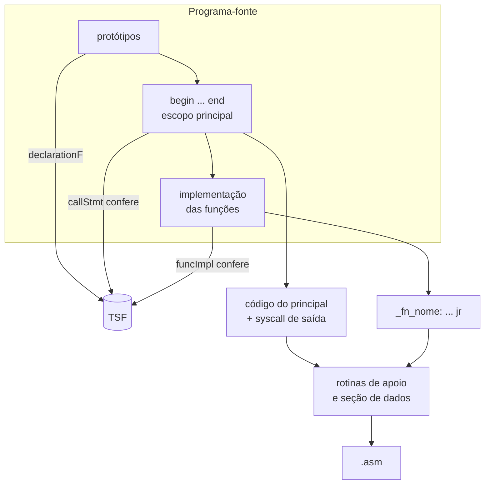

# Funções: prototipação, chamada e implementação

**Quinta etapa e primeira versão completa do compilador: protótipos numa tabela de símbolos de funções, chamadas verificadas contra o protótipo e implementação após o escopo principal, com desvio por `jal` e retorno por `jr`.**

[](https://gcc.gnu.org/)
[](makefile)
[](https://www.nasm.us/)
[](#como-compilar-e-testar)
[](../)

Versão final do compilador de C simplificado da disciplina de Compiladores (UFMT). Reúne o que foi construído nas etapas anteriores (tipos, expressões, `if`/`else`, `while`, atribuição, `read` e `write`) e acrescenta funções. Como permitido no enunciado, parâmetros e variáveis das funções são globais, e as funções funcionam como procedimentos, sem valor de retorno.

Etapa 5 de 5 · anterior: [`if`, `while` e operadores lógicos](../condicional_se)

---

## Sumário

- [Destaques](#destaques)
- [Como funciona](#como-funciona)
- [Gramática](#gramática)
- [Requisito 1: prototipação e TSF](#requisito-1-prototipação-e-tsf)
- [Requisito 2: chamada de função](#requisito-2-chamada-de-função)
- [Requisito 3: implementação das funções](#requisito-3-implementação-das-funções)
- [Estrutura do projeto](#estrutura-do-projeto)
- [Como compilar e testar](#como-compilar-e-testar)
- [Limitações](#limitações)

---

## Destaques

- **Tabela de símbolos de funções (TSF)** com tipo, label, parâmetros e indicadores de implementação e chamada; impressa com `./compiler -ts`.
- **Chamadas verificadas:** existência da função, número de argumentos e compatibilidade de cada argumento com o parâmetro.
- **Implementação conferida com o protótipo** (tipo, quantidade, tipos e nomes dos parâmetros) e aviso para função chamada sem implementação.
- **`jal`/`jr` como macros NASM** sobre `call`/`ret`, o que permite que funções chamem outras e a si mesmas.
- **Testes automatizados:** 11 programas com saída esperada e 47 casos de erro, verificados em Linux, macOS e Windows.

## Como funciona



A implementação foi feita sobre o compilador de [condicional_se/](../condicional_se). O código de referência da disciplina (código #10) está guardado sem alterações em [referencia_codigo10/](referencia_codigo10); ele não compila, porque `synt.c` chama `sym_find(id_name)` sem o segundo argumento e tem um `))` sobrando.

## Gramática

```
program      -> declarations begin statements end func_code
declarations -> declaration declarations | ε
declaration  -> type id ( declarationV | declarationF )
declarationV -> ;
declarationF -> ( param_list ) ;
param_list   -> type id { , type id } | ε
type         -> int | float | char | string

func_code    -> func_impl func_code | ε
func_impl    -> type id ( param_list ) begin declarations statements end

statements   -> statement statements | ε
statement    -> read_stmt | write_stmt | if_stmt | while_stmt | id_stmt
id_stmt      -> id ( assign_stmt | call_stmt )
assign_stmt  -> = valor ;
call_stmt    -> ( [ arg { , arg } ] ) ;
arg          -> id | E | string_const
```

As regras de `if`, `while`, `read`, `write` e das expressões (`B`, `E`, `T`, `F`) são as mesmas de [condicional_se/](../condicional_se). Os blocos aceitam tanto `begin`/`end` quanto `{`/`}`.

- **Declaração de variável × de função.** As duas começam com `tipo id`. O token seguinte decide: `;` é variável (`declarationV`) e `(` é função (`declarationF`).
- **Atribuição × chamada.** `id = E;` e `id(...);` também começam com `id`. A regra `id_stmt` consome o `id` e decide pelo token seguinte: `=` ou `(`.

Exemplo ([testes/funcoes_procedimentos.cc](testes/funcoes_procedimentos.cc), resumido):

```c
int total;
int soma(int a, int b);          // prototipo: soma, a e b vao para as tabelas
int saudacao(string quem);

begin                            // escopo principal (sem cabecalho de funcao)
    soma(2, 3);                  // a = 2; b = 3; jal _fn_soma
    write total;                 // 5
    a = 10;
    soma(a, 4 * 5 - 1);          // 'a' ja eh o parametro; b = 19
    write total;                 // 29
    saudacao("UFMT");
end

int soma(int a, int b) {         // codigo das funcoes, depois do principal
    total = a + b;
}

int saudacao(string quem) begin
    write "ola,";
    write quem;
end
```

## Requisito 1: prototipação e TSF

**Módulo Symbol** ([symbols.h](symbols.h), [symbols.c](symbols.c)):

| Item | Implementação |
|---|---|
| Estrutura da TSF | `type_symbol_table_func`: vetor de `type_symbol_table_func_entry` com tipo, nome, **label**, parâmetros (tipo e nome, na ordem do protótipo), quantidade de parâmetros e os indicadores `implemented` e `called` |
| Inserção | `sym_func_declare(nome, tipo, params, n_params)`: copia os dados, gera e registra o label `_fn_<nome>` e inicia `implemented`/`called` com `false` |
| Busca | `sym_func_find(nome)`: devolve a entrada ou `NULL` |
| Inicialização | `initSymbolTableFunc()`, chamada no `main` com as outras tabelas |
| Impressão (debug) | `printSTFunc()`. O compilador imprime todas as tabelas com a opção `-ts`: `./compiler -ts prog.cc` |

O label recebe o prefixo `_` porque um identificador da linguagem não pode começar com `_`. Assim, ele nunca conflita com o nome de uma variável.

**Módulo Synt** ([synt.c](synt.c)):

- `program()` exige `begin ... end` em volta do escopo principal e depois chama `funcCode()`.
- `declaration()` reconhece `tipo id` e escolhe entre `declarationV()` e `declarationF()`.
- `declarationF()` verifica se a função já está na TSF. Se não estiver, reconhece a lista de parâmetros (`paramList()`), registra cada parâmetro como variável global e insere a função na TSF.

Saída de `./compiler -ts testes/funcoes_recursao_args.cc` (trecho):

```
TABELA DE SIMBOLOS DE FUNCOES:
Numero de funcoes = 3
	funcao[0].name:troca
	funcao[0].type:264 (int)
	funcao[0].label:_fn_troca
	funcao[0].n_params:2
		param[0]: type:264 (int) name:p
		param[1]: type:264 (int) name:q
	funcao[0].implemented:1
	funcao[0].called:1
	...
```

## Requisito 2: chamada de função

`callStmt()` só continua se todos os testes abaixo passarem. Se algum falhar, a compilação é interrompida com a mensagem correspondente:

1. O id está na TSF. Se não estiver, a mensagem diz se ele é uma variável ou se não foi declarado.
2. A quantidade de argumentos é a do protótipo. Os argumentos a mais também são contados, para que a mensagem informe o total.
3. Cada argumento é adequado ao parâmetro correspondente (`argument()`):

| Argumento | Regra | Código gerado |
|---|---|---|
| `id` sozinho | Precisa ser **o mesmo id** do parâmetro (e, portanto, do mesmo tipo), já que o parâmetro é uma variável global | nada: o valor já está no parâmetro |
| expressão `E` (número, constante char, `x + 1`, ...) | O tipo precisa ser compatível com o do parâmetro, como na atribuição: `int`/`char` não recebem `float` nem comparação; para `float`, o `int` é convertido | a expressão é avaliada e o valor é copiado para o parâmetro |
| constante string | Só para parâmetro `string` | `_rt_strcpy` para o parâmetro |

Para saber se o argumento é um `id` sozinho ou o começo de uma expressão (`a` ou `a + 1`), o `id` é consumido e o token seguinte é examinado. Se for `,` ou `)`, é um `id` sozinho. Caso contrário, a expressão continua a partir dele (`TR`/`ER`).

Primeiro todos os argumentos são avaliados e empilhados. Só depois eles são copiados para os parâmetros, do último para o primeiro. Assim, em `troca(q + 0, p + 0)` (parâmetros `p` e `q`), o segundo argumento ainda usa o valor antigo de `p`.

## Requisito 3: implementação das funções

- **Fim do programa.** O código do escopo principal termina com a chamada de sistema de saída (`gen_epilog_code`), logo depois do `end`. O código das funções é gerado a seguir, depois vêm as rotinas de apoio e, por fim, a seção de dados.
- **`func_code`.** Depois do `end` do principal só pode haver implementações de funções. `funcImpl()` verifica que a função:
  - foi prototipada (está na TSF);
  - ainda não foi implementada;
  - tem o mesmo tipo e os mesmos parâmetros do protótipo (quantidade, tipos e nomes).
- **Variáveis locais.** O corpo pode começar com declarações de variáveis, que também vão para a TS global. Protótipos dentro de uma função são rejeitados.
- **Funções chamadas.** Ao final, `checkCalledFunctions()` verifica que toda função chamada foi implementada. Sem essa verificação, o `jal` não teria destino. Uma função prototipada que nunca é chamada não precisa ser implementada.
- **`jal` e `jr`.** O x86-64 não tem as instruções `jal`/`jr` do MIPS/RISC-V. O preâmbulo do `.asm` define duas macros do NASM com esses nomes:

```nasm
;jal <label>: salta para a funcao, guardando o endereco de retorno
%macro jal 1
	call %1
%endmacro
;jr: retorna ao ponto de chamada (endereco guardado pelo jal)
%macro jr 0
	ret
%endmacro
```

Como `call` guarda o endereço de retorno na pilha, uma função pode chamar outra e também a si mesma. O teste [funcoes_recursao_args.cc](testes/funcoes_recursao_args.cc) faz uma contagem regressiva recursiva.

Código gerado para `soma(2, 3);` e para a função `soma` (comentários omitidos):

```nasm
	mov rax, 2
	push rax
	mov rax, 3
	push rax
	pop rax
	mov [b], rax          ; ultimo argumento -> ultimo parametro
	pop rax
	mov [a], rax
	jal _fn_soma
	...
	mov rax, SYS_EXIT     ; fim do escopo principal
	xor rdi, rdi
	syscall

_fn_soma:
	push qword [a]
	push qword [b]
	pop rbx
	pop rax
	add rax, rbx
	push rax
	pop rax
	mov [total], rax
	jr
```

## Estrutura do projeto

| Arquivo | Alteração em relação a [condicional_se/](../condicional_se) |
|---|---|
| [struct_compiler.h](struct_compiler.h) | Token `COMMA` (`,`). |
| [lex.c](lex.c) | Reconhece a vírgula. |
| [symbols.h](symbols.h) / [symbols.c](symbols.c) | Estrutura, inserção, busca, inicialização e impressão da TSF. |
| [synt.h](synt.h) / [synt.c](synt.c) | Novas regras `program`, `declaration`, `declarationV`, `declarationF`, `paramList`, `idStmt`, `callStmt`, `argument`, `funcCode`, `funcImpl` e `checkCalledFunctions`. Opção `-ts` no `main`. |
| [gen.h](gen.h) / [gen.c](gen.c) | Macros `jal`/`jr` no preâmbulo e as funções `gen_call`, `gen_func_begin` e `gen_func_end`. |
| [referencia_codigo10/](referencia_codigo10) | Código #10 da disciplina (referência), sem alterações. |
| [testes/](testes) | Os testes da etapa anterior agora estão dentro de `begin ... end`. Há 2 novos programas válidos e 25 novos casos de erro. |
| [tst_lex.c](tst_lex.c) | Teste isolado do léxico: imprime a tag, o nome da tag e o lexema de cada token do arquivo, e para no primeiro erro léxico (`make tstLex`, depois `./tstLexCompiler arquivo`) |

## Como compilar e testar

```bash
make                      # gera ./compiler (codigo para Linux)
./compiler testes/funcoes_procedimentos.cc      # gera testes/funcoes_procedimentos.cc.asm
./compiler -ts testes/funcoes_procedimentos.cc  # idem, imprimindo as tabelas de simbolos
make testes               # compila tudo de testes/ e confere se tudo de testes/erros/ e rejeitado
make executar             # compila, monta, liga e executa os testes, comparando com os .out
make tstLex               # teste isolado do léxico: ./tstLexCompiler arquivo.cc
make clean
```

A montagem e a ligação em cada plataforma são as mesmas de [condicional_se/](../condicional_se#como-compilar-e-testar). No macOS, use `make compiler_macos` antes de `sh testes/rodar.sh`.

### Programas de teste

| Programa | O que testa |
|---|---|
| [funcoes_procedimentos.cc](testes/funcoes_procedimentos.cc) | Função sem parâmetros; argumentos `id`, número, expressão e constante string; parâmetros `int`, `float` (com conversão de `int`) e `string`; corpo com `{ }` e com `begin`/`end`; variável local; `while`/`if` dentro da função; função chamando função; protótipo nunca chamado nem implementado |
| [funcoes_recursao_args.cc](testes/funcoes_recursao_args.cc) | Recursão; ordem de cópia dos argumentos (`troca(q + 0, p + 0)`); `read` dentro da função |
| Os 9 programas de [condicional_se/](../condicional_se) | `if`/`else`, `while`, atribuição, entrada e saída, agora dentro de `begin ... end` |

Os 11 programas compilam, montam, ligam e produzem a saída esperada no Linux (Docker, imagem `gcc:13`), no macOS x86-64 e no Windows (`x86_64-w64-mingw32-gcc` e wine). Os 47 casos de erro são rejeitados. O código compila sem avisos com `gcc -Wall -Wextra`, e o compilador roda sem erros com `-fsanitize=address,undefined` em todos os testes.

Casos de erro de funções (em [testes/erros/](testes/erros)):

| Entrada | Mensagem |
|---|---|
| `soma(1, 2);` sem protótipo | `Funcao 'soma' nao declarada (sem prototipo).` |
| `soma(1);` com `soma(int a, int b)` | `Quantidade de parametros incorreta na chamada de 'soma': informado(s) 1, esperado(s) 2. Prototipo: soma(int a, int b).` |
| `soma(1, 2, "ufmt", 3);` (exemplo do código #10) | `... informado(s) 4, esperado(s) 2. Prototipo: soma(int x, int y).` |
| `soma(x, b);` com `soma(int x, int y)` | `Parametro 2 da chamada de 'soma' deve ser o id 'y' (parametros sao variaveis globais), encontrado 'b'. ...` |
| `dobro(2.5);` com `dobro(int n)` | `Parametro 1 da chamada de 'dobro' (int) nao pode receber uma expressao float. ...` |
| `dobro("dois");` | `Parametro 1 da chamada de 'dobro' deve ser int, encontrada a constante string "dois". ...` |
| `saudacao(3);` com `saudacao(string quem)` | `Parametro 1 da chamada de 'saudacao' (string) deve receber uma constante string ou o proprio id 'quem'. ...` |
| dois protótipos `soma` | `Funcao 'soma' ja declarada.` |
| `int a; int soma(int a, int b);` | `Parametro 'a' da funcao 'soma' ja declarado (parametros sao variaveis globais).` |
| `int soma; int soma(int a, int b);` | `'soma' ja foi declarado como variavel.` |
| `int soma(int a, b);` | `Declaracao de parametro incorreta: esperado um tipo (int, float, char ou string), encontrado 'b'.` |
| implementação sem protótipo | `Funcao 'soma' nao prototipada: so podem ser implementadas funcoes declaradas antes do 'begin'.` |
| função implementada duas vezes | `Funcao 'mostra' ja implementada.` |
| `soma(int a, float b)` com protótipo `soma(int a, int b)` | `Parametro 2 da implementacao de 'soma' (float b) difere do prototipo: soma(int a, int b).` |
| `soma(int a)` com protótipo de 2 parâmetros | `Funcao 'soma' implementada com 1 parametro(s), mas o prototipo tem 2: soma(int a, int b).` |
| `float soma(...)` com protótipo `int soma(...)` | `Funcao 'soma' implementada com tipo float, mas prototipada com tipo int.` |
| função chamada e não implementada | `Funcao 'mostra' chamada mas nao implementada.` |
| `x = mostra + 1;` | `'mostra' eh uma funcao sem valor de retorno (procedimento) e nao pode ser usada em expressoes.` |
| `mostra = 1;` | `'mostra' eh uma funcao e nao pode receber valor.` |
| protótipo dentro de uma função | `Funcao 'outra' declarada dentro de outra funcao: os prototipos devem vir antes do 'begin' do escopo principal.` |
| `mostra()` sem `;` | `Entrada inesperada: 'end'. Esperado: ';'.` |
| `x;` | `Esperado '=' (atribuicao) ou '(' (chamada de funcao) apos 'x', encontrado ';'.` |
| comandos sem `begin` | `Entrada inesperada: 'x'. Esperado: '{' (ou 'begin').` |
| comando depois do `end` do principal | `Apos o 'end' do escopo principal so pode haver a implementacao de funcoes, encontrado 'write'.` |
| `int a;` dentro de `soma(int a, int b)` | `Variavel 'a' ja declarada.` |

## Limitações

- Parâmetros e variáveis das funções são globais. Por isso, um mesmo nome não pode ser usado em escopos diferentes: dois parâmetros de funções diferentes, ou um parâmetro e uma variável, não podem ter o mesmo nome.
- Um argumento que seja um `id` sozinho precisa ser o próprio parâmetro. Para passar outra variável, use uma expressão, por exemplo `dobro(x + 0)`. Para `string`, use a constante ou atribua antes ao parâmetro (`quem = nome; saudacao(quem);`).
- Não há retorno de valor. O tipo declarado da função é verificado entre o protótipo e a implementação, mas não é usado. Uma função não pode aparecer em expressões.
- Na recursão, as chamadas compartilham as mesmas variáveis globais. Ela só funciona quando nenhum valor do chamador é usado depois da chamada recursiva, como em [funcoes_recursao_args.cc](testes/funcoes_recursao_args.cc).

---

Etapa 5 de 5 · anterior: [`if`, `while` e operadores lógicos](../condicional_se)

[← Compiladores](../) · [Repositório principal](../../)
