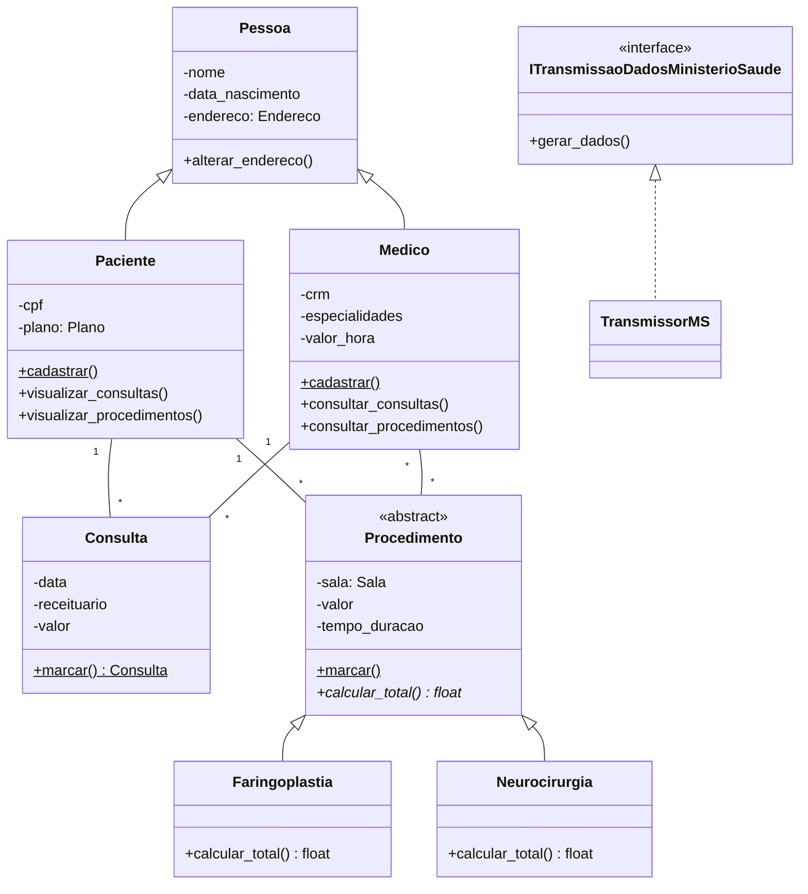

# Sistema Hospitalar: estudo de caso de modelagem de domínio

**Modelo de domínio de um hospital em Python orientado a objetos, no estilo não anêmico: pacientes, médicos, consultas e procedimentos com as regras de negócio dentro das próprias classes.**

[](https://www.python.org/)
[](#modelo-de-domínio)
[](../)

Estudo de caso da disciplina de Engenharia de Software (UFMT). O objetivo é traduzir o diagrama de classes do domínio hospitalar para código, aplicando o **modelo de domínio rico** (*Domain Model*): as classes guardam dados **e** comportamento, em vez de serem estruturas vazias manipuladas por serviços externos.

---

## Destaques

- **Herança e polimorfismo:** `Faringoplastia` e `Neurocirurgia` implementam de formas diferentes o cálculo do valor total definido em `Procedimento`.
- **Associações mantidas pelo domínio:** marcar uma consulta ou um procedimento já o vincula ao paciente e ao médico.
- **Encapsulamento:** atributos protegidos, expostos por propriedades e métodos de comportamento.
- **Interface para integração externa:** `ITransmissaoDadosMinisterioSaude` define o envio dos procedimentos ao Ministério da Saúde.
- **Objetos de valor** separados das entidades (`Endereco`, `Plano`, `Sala`, `Especialidade`).

## Modelo de domínio



### Regras de negócio nas classes

| Classe | Comportamento | Princípio |
|---|---|---|
| `Paciente` | `visualizar_consultas()`, `visualizar_procedimentos()` | Encapsulamento |
| `Consulta` | `marcar()` cria a consulta e a associa ao paciente e ao médico | Lógica agrupada na entidade |
| `Procedimento` | `marcar()` define a data e associa o procedimento | Lógica agrupada na entidade |
| `Faringoplastia` | `calcular_total()` soma 10% de coparticipação ao valor base | Herança e polimorfismo |
| `Neurocirurgia` | `calcular_total()` devolve o valor base, sem coparticipação | Herança e polimorfismo |
| `TransmissorMS` | `gerar_dados()` lista cada procedimento e seu valor total | Programação para interface |

## Como executar

**Pré-requisito:** Python 3.10+ (sem dependências externas).

```bash
cd src
python3 main.py
```

O `main.py` simula o fluxo completo: cadastra um paciente e um médico, marca uma consulta e dois procedimentos e calcula os valores. Trecho da saída:

```text
Consultas de Maria Silva: 1
Procedimentos de Maria Silva: 2
Valor Total Faringoplastia (10% copart.): R$ 5500.00
Valor Total Neurocirurgia (sem copart.): R$ 15000.00

--- Transmissão de Dados ao Ministério da Saúde ---
Procedimento: Faringoplastia, Valor Total: R$ 5500.00
Procedimento: Neurocirurgia, Valor Total: R$ 15000.00
```

## Estrutura do projeto

```text
Sistema_Hospitalar/
└── src/
    ├── main.py                 # simulação do fluxo do hospital
    └── domain/
        ├── entities.py         # Pessoa, Paciente, Medico, Consulta, interface de transmissão
        ├── procedures.py       # Procedimento (abstrata), Faringoplastia, Neurocirurgia
        └── value_objects.py    # Endereco, Plano, Sala, Especialidade
```

## Limitações

- A persistência é simulada por um dicionário global (`REPOSITORIO_HOSPITALAR`), apagado ao fim da execução.
- Os métodos `cadastrar` e `marcar` são estáticos e acessam esse dicionário diretamente, como no diagrama UML do estudo de caso; numa aplicação real, ficariam num repositório separado.

---

[← Engenharia de Software](../) · [Repositório principal](../../)
