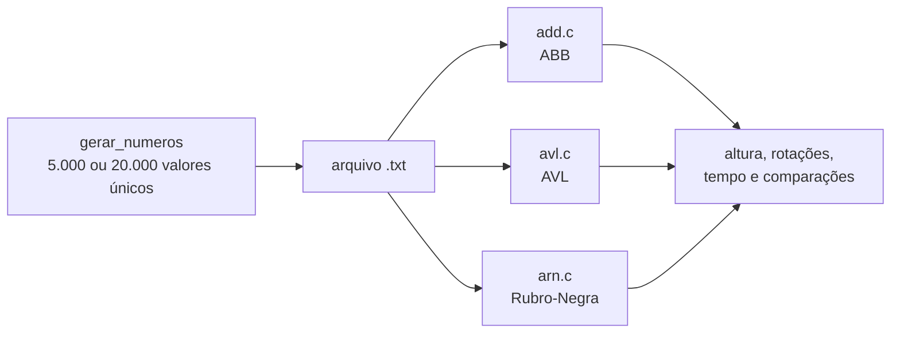

# Árvores Binárias Balanceadas: ABB, AVL e Rubro-Negra

**Implementação e comparação de três árvores binárias de busca em C, medindo altura, rotações, tempo e número de comparações nas buscas.**

[](https://gcc.gnu.org/)
[](%C3%81rvores-Bin%C3%A1rias-Relat%C3%B3rio.pdf)
[](../)

Trabalho da disciplina de Estrutura de Dados II (UFMT). As três árvores recebem os mesmos conjuntos de números aleatórios, e a comparação mostra o efeito do balanceamento: a árvore sem balanceamento cresce mais e exige mais comparações por busca, enquanto AVL e Rubro-Negra pagam esse ganho com rotações na inserção.

---

## Destaques

- **Três implementações independentes:** ABB clássica, AVL e Rubro-Negra, com inserção, busca, altura e percurso em ordem.
- **Contagem de rotações** na AVL e na Rubro-Negra.
- **Avaliação de busca:** 20% dos valores são sorteados e buscados, com tempo total e número de comparações.
- **Gerador de dados** com números únicos entre 1 e 100.000.

## Como funciona



| Etapa | O que faz |
|---|---|
| 1. Geração de dados | Cria arquivos com 5.000 e 20.000 inteiros únicos entre 1 e 100.000 |
| 2. Implementação | Constrói cada árvore a partir do arquivo |
| 3. Desempenho | Mede a altura final e o número de rotações das inserções |
| 4. Busca | Sorteia 20% dos valores e mede tempo e comparações para encontrá-los |

## Como executar

```bash
gcc gerar_numeros.c -o gerar_numeros
gcc add.c -o add
gcc avl.c -o avl
gcc arn.c -o arn

./gerar_numeros 5000 arquivo_5000.txt
./add arquivo_5000.txt
./avl arquivo_5000.txt
./arn arquivo_5000.txt
```

Cada programa imprime a árvore em ordem, a altura, as rotações (AVL e Rubro-Negra) e as métricas de busca.

### Exemplo de resultado

Uma execução com 5.000 valores (os números variam a cada geração):

| Árvore | Altura | Rotações | Comparações nas buscas |
|---|---|---|---|
| ABB | 30 | — | 15.569 |
| AVL | 15 | 2.356 | 11.659 |
| Rubro-Negra | 15 | 2.963 | 11.629 |

A análise completa, com 5.000 e 20.000 valores, está no [relatório](%C3%81rvores-Bin%C3%A1rias-Relat%C3%B3rio.pdf).

## Estrutura do projeto

```text
Tarefa1_Arvores_Binarias_Balanceadas/
├── gerar_numeros.c              # gerador de números únicos aleatórios
├── add.c                        # árvore binária de busca
├── avl.c                        # árvore AVL
├── arn.c                        # árvore Rubro-Negra
└── Árvores-Binárias-Relatório.pdf
```

---

[← Estrutura de Dados II](../) · [Estrutura de Dados em C](../../) · [Repositório principal](../../../)
