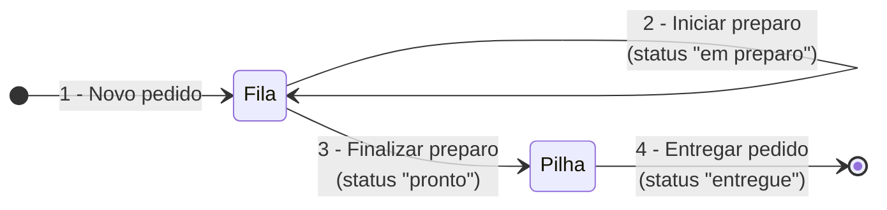

# Gerenciador de Pedidos de Restaurante: Fila e Pilha

**Sistema de pedidos em C que combina estruturas lineares: os pedidos aguardam o preparo numa fila e, quando ficam prontos, vão para uma pilha de entrega.**

[](https://gcc.gnu.org/)
[](../)

Trabalho prático da disciplina de Estrutura de Dados I (UFMT). O sistema simula a cozinha de um restaurante, com a interface (`main.c`), as estruturas de dados (`fila`, `pilha`) e a entidade de domínio (`pedido`) em módulos separados.

---

## Como funciona



| Opção do menu | Efeito |
|---|---|
| 1 - Novo pedido | Lê número, cliente e itens e coloca o pedido no fim da fila |
| 2 - Iniciar preparo | Marca o primeiro da fila como "em preparo" |
| 3 - Finalizar preparo | Marca o primeiro da fila como "pronto", retira-o da fila e o empilha |
| 4 - Entregar pedido | Marca o topo da pilha como "entregue" e o desempilha |
| 5 - Sair | Encerra o programa |

A fila garante que os pedidos sejam preparados na ordem de chegada (FIFO); a pilha entrega primeiro o último pedido que ficou pronto (LIFO).

## Como executar

```bash
gcc main.c pedido.c fila.c pilha.c -o pedidos
./pedidos
```

## Estrutura do projeto

```text
Trabalho_Aplicacao-de-listas-pilha-fila/
├── main.c                              # menu e fluxo dos pedidos
├── pedido.h / pedido.c                 # struct Pedido: criar, alterar status, imprimir
├── fila.h / fila.c                     # fila encadeada de pedidos
├── pilha.h / pilha.c                   # pilha encadeada de pedidos
└── Trab-Lista_Fila_Pilha-pratica.pdf   # enunciado
```

---

[← Estrutura de Dados em C](../) · [Repositório principal](../../)
