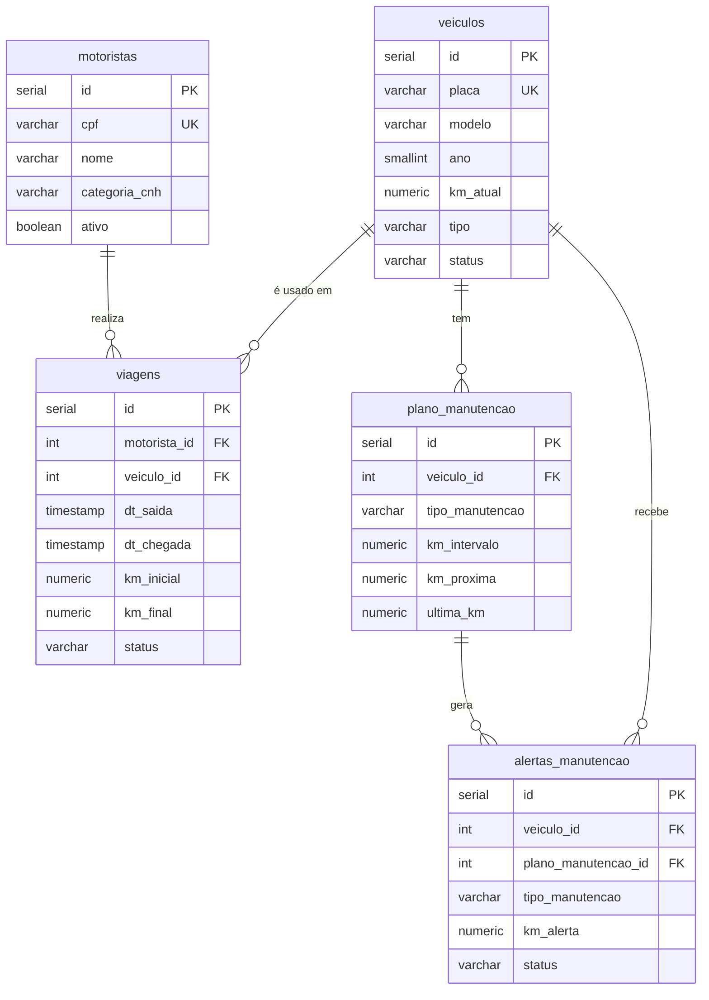
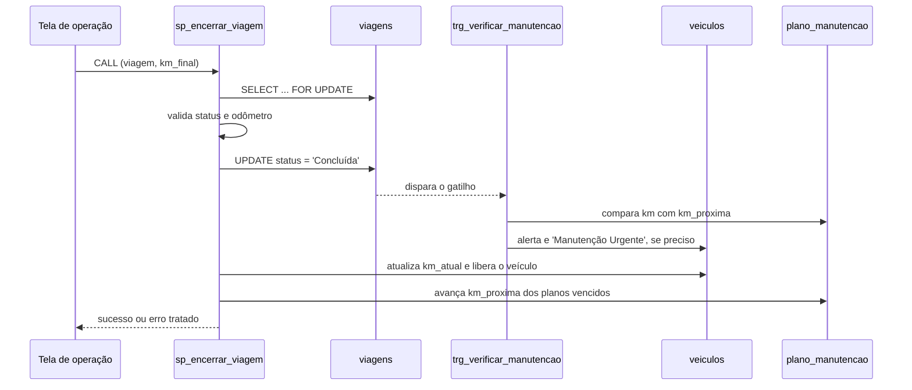

# FrotaGesta: controle de frota e manutenção preventiva

**Sistema desktop para controlar a frota de uma transportadora: viagens, motoristas, veículos e alertas automáticos de manutenção, com as regras de negócio críticas dentro do PostgreSQL.**

[](https://www.postgresql.org/)
[](#regras-de-negócio)
[](https://www.python.org/)
[](https://github.com/TomSchimansky/CustomTkinter)
[](../)

Projeto da disciplina de Laboratório de Banco de Dados (UFMT, Campus Araguaia, prof. Dr. Anthony Ferreira La Marca), feito por **Raissa Caroline Cavalcanti da Silva** e **Luis Henrique Avlis Ferraz** (Barra do Garças, MT, julho de 2026).

Uma transportadora local tem caminhões, vans e carros e precisa controlar o uso dos veículos, registrar viagens e ser avisada das manutenções preventivas (troca de óleo, pastilhas etc.) antes que um veículo quebre em rota. O FrotaGesta concentra as regras críticas no banco, com restrições, gatilhos e um procedimento armazenado, e oferece uma interface desktop em Python para o setor operacional e a oficina.

---

## Sumário

- [Destaques](#destaques)
- [Modelo de dados](#modelo-de-dados)
- [Regras de negócio](#regras-de-negócio)
- [Funcionalidades da interface](#funcionalidades-da-interface)
- [Como executar](#como-executar)
- [Estrutura do projeto](#estrutura-do-projeto)
- [Solução de problemas](#solução-de-problemas)

---

## Destaques

- **Regras no banco, não só na tela:** a CNH incompatível com o veículo é barrada por gatilho, mesmo que alguém insira dados direto no SQL.
- **Alertas automáticos:** ao concluir uma viagem, um gatilho compara o odômetro com os planos de manutenção, gera alertas e marca o veículo como "Manutenção Urgente".
- **Encerramento atômico:** a procedure `sp_encerrar_viagem` trava a viagem, valida, atualiza viagem, odômetro e planos numa única transação.
- **Painel pronto para consulta:** views `vw_painel_veiculos` e `vw_historico_viagens` alimentam o dashboard.
- **Validações na interface** de CPF (dígitos verificadores) e placa (padrão antigo e Mercosul).
- **Testes funcionais em SQL** de todas as regras de negócio (`07_testes.sql`).

## Modelo de dados



## Regras de negócio

| Regra | Implementação |
|---|---|
| Quilometragem final ≥ inicial; chegada ≥ saída | `CHECK` em `viagens` |
| Motorista sem CNH D, E, AD ou AE não dirige caminhão | Gatilho `trg_validar_cnh_veiculo` (`BEFORE INSERT/UPDATE` em `viagens`) |
| Alerta automático de manutenção preventiva | Gatilho `trg_verificar_manutencao` (`AFTER UPDATE` em `viagens`) |
| Encerramento de viagem em transação atômica | Procedure `sp_encerrar_viagem` |
| Um plano por tipo de manutenção em cada veículo | `UNIQUE (veiculo_id, tipo_manutencao)` |
| CPF e placa válidos antes de enviar ao banco | `app/ui/validacoes.py` |

### Encerramento de uma viagem



## Funcionalidades da interface

- **Dashboard:** contadores de veículos disponíveis, em rota e em manutenção urgente, tabela colorida por status e lista de alertas pendentes, com opção de marcar como resolvido.
- **Motoristas:** cadastro com validação de CPF e categoria da CNH.
- **Veículos:** cadastro com validação de placa.
- **Operação:** início e conclusão de viagens, com mensagens amigáveis para os erros devolvidos pelo banco (CNH inválida, quilometragem incoerente etc.).

## Como executar

**Pré-requisitos:** PostgreSQL 16 (ou compatível), Python 3.12 e as bibliotecas `customtkinter` e `psycopg2-binary`.

### 1. Instalar e iniciar o PostgreSQL (macOS)

```bash
brew install postgresql@16
brew services start postgresql@16
```

Em instalações recentes, defina uma senha para o seu usuário:

```sql
-- psql postgres
ALTER USER seu_usuario WITH PASSWORD 'sua_senha';
```

### 2. Criar e popular o banco

```sql
-- psql postgres
CREATE DATABASE frotagesta ENCODING='UTF8' TEMPLATE=template0;
```

Se o sistema tiver o locale `pt_BR.UTF-8`, use o `sql/00_criar_banco.sql`, que já define a ordenação em português.

A partir da pasta `frotagesta/`, execute os scripts em ordem numérica (cada um depende dos anteriores):

```bash
for f in sql/0{0,1,2,3a,3b,4,5,6}_*.sql; do psql -d frotagesta -f "$f"; done
psql -d frotagesta -f sql/07_testes.sql   # testes funcionais das regras
```

### 3. Configurar a conexão

Em `app/db/conexao.py`:

```python
CONFIG = {
    "dbname":   "frotagesta",
    "user":     "seu_usuario",
    "password": "sua_senha",
    "host":     "localhost",
    "port":     5432,
}
```

### 4. Rodar a aplicação

```bash
cd app
python3 -m venv venv
source venv/bin/activate
pip install customtkinter psycopg2-binary
PYTHONPATH=. python3 main.py
```

**Inspecionar no DBeaver:** crie uma conexão PostgreSQL com host `localhost`, porta `5432`, banco `frotagesta` e o mesmo usuário de `conexao.py`.

## Estrutura do projeto

```text
frotagesta/
├── sql/
│   ├── 00_criar_banco.sql          # cria o banco (locale pt_BR)
│   ├── 01_tabelas.sql              # 5 tabelas com restrições e chaves estrangeiras
│   ├── 02_indices.sql              # índices em chaves estrangeiras e colunas de status
│   ├── 03a_trigger_cnh.sql         # gatilho de CNH × tipo de veículo
│   ├── 03b_trigger_manutencao.sql  # gatilho de alertas de manutenção
│   ├── 04_procedure.sql            # procedure sp_encerrar_viagem
│   ├── 05_views.sql                # vw_painel_veiculos e vw_historico_viagens
│   ├── 06_seed.sql                 # dados de teste
│   └── 07_testes.sql               # testes funcionais das regras de negócio
└── app/
    ├── main.py                     # ponto de entrada
    ├── db/                         # conexão (psycopg2) e acesso a motoristas, veículos e viagens
    └── ui/                         # telas (dashboard, motoristas, veículos, operação),
                                    # componentes reutilizáveis e validações
```

## Solução de problemas

| Mensagem | Solução |
|---|---|
| `fe_sendauth: no password supplied` | Defina uma senha para o usuário do PostgreSQL e preencha `user` e `password` em `conexao.py` |
| `connection to server on socket ".../.s.PGSQL.5432" failed` | O PostgreSQL não está rodando: `brew services start postgresql@16` |
| Erro de objeto inexistente ao rodar um script | Rode os scripts a partir da pasta `frotagesta/` e na ordem numérica |
| `ModuleNotFoundError: customtkinter` | Ative o ambiente virtual e instale as dependências |

## Limitações

- A conexão com o banco é configurada direto em `conexao.py`, sem variáveis de ambiente.
- Não há autenticação de usuários na interface.

---

[← Laboratório de Banco de Dados](../) · [Repositório principal](../../)
