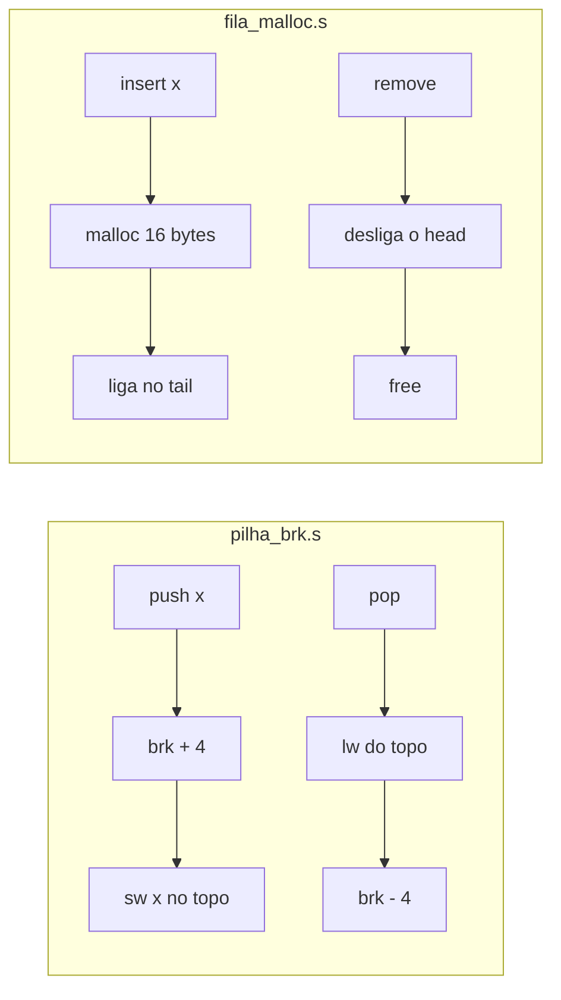

# Pilha com `brk` e Fila com `malloc`/`free` em Assembly RISC-V

**Duas estruturas de dados dinâmicas em Assembly RISC-V 64 bits, com menu interativo: uma pilha que gerencia o heap sozinha pela chamada de sistema `brk` e uma fila encadeada que usa `malloc` e `free` da libc.**

[](https://riscv.org/)
[](#sobre-o-projeto)
[](https://www.qemu.org/)
[](#como-rodar)
[](../)

Trabalho da disciplina de Organização de Computadores (UFMT, prof. Linder Cândido), feito por **Raissa Cavalcanti** e **Vitória Calonga**. O contraste entre as duas partes mostra o que a libc faz por baixo: na pilha, cada operação move o *program break* diretamente; na fila, a alocação de cada nó fica a cargo do `malloc`.

O passo a passo dos conceitos e da implementação está em [`explicacao.md`](explicacao.md).

---

## Sumário

- [Destaques](#destaques)
- [Como funciona](#como-funciona)
- [Sobre o projeto](#sobre-o-projeto)
- [Parte 1 — Pilha com brk](#parte-1--pilha-com-brk)
- [Parte 2 — Fila com malloc/free](#parte-2--fila-com-mallocfree)
- [Como rodar](#como-rodar)
- [Estrutura do projeto](#estrutura-do-projeto)
- [Tecnologias](#tecnologias)

---

## Destaques

- **Pilha sem nenhuma biblioteca de alocação:** `empilha` sobe o *break* 4 bytes e grava com `sw`; `desempilha` lê com `lw` e desce o *break*.
- **Fila encadeada FIFO** com nós de 16 bytes (valor, alinhamento e ponteiro), inserção no fim e remoção no início.
- **Menus interativos** que mostram o endereço do *break* e dos nós a cada operação.
- **Execução em qualquer máquina** com Docker, compilação cruzada e emulação do QEMU em modo usuário.

## Como funciona



## Sobre o projeto

Implementação de duas estruturas de dados dinâmicas em **Assembly RISC-V 64-bit**, com menu interativo para o usuário inserir e remover valores em tempo de execução.

| Arquivo | Estrutura | Política | Alocação de memória |
|---|---|---|---|
| `pilha_brk.s` | Pilha | LIFO | syscall `brk` (nº 214) |
| `fila_malloc.s` | Fila | FIFO | `malloc` / `free` da libc |

---

## Parte 1 — Pilha com `brk`

A memória é gerenciada **exclusivamente** pela syscall `brk`, sem uso de `malloc`, `free` ou qualquer biblioteca de alocação. O topo da pilha coincide sempre com o *program break*.

- **`empilha(x)`** — move o break `+4` bytes e grava o valor com `sw`
- **`desempilha()`** — lê o topo com `lw` e move o break `-4` bytes

O programa principal oferece um **menu interativo**:

```
========================================
   PILHA DINAMICA NO HEAP COM brk
========================================

[1] Push (empilhar)
[2] Pop  (desempilhar)
[0] Sair
Opcao: 1
Valor a empilhar: 10
   >> PUSH(10) realizado.
   >> brk: 0x4000024000 -> 0x4000024004  (+4 bytes alocados)
----------------------------------------
Opcao: 1
Valor a empilhar: 20
   >> PUSH(20) realizado.
   >> brk: 0x4000024004 -> 0x4000024008  (+4 bytes alocados)
----------------------------------------
Opcao: 2
   >> POP() = 20
   >> brk: 0x4000024008 -> 0x4000024004  (-4 bytes liberados)
----------------------------------------
```

---

## Parte 2 — Fila com `malloc`/`free`

A fila é uma **lista encadeada** onde cada nó (16 bytes) é alocado com `malloc` e liberado com `free`. Inserção ocorre no final (`tail`), remoção no início (`head`).

Estrutura de cada nó:
```
offset 0: value (4 bytes) — inteiro armazenado
offset 4: padding (4 bytes)
offset 8: next*  (8 bytes) — ponteiro para o próximo nó
```

O programa principal oferece um **menu interativo**:

```
========================================
   FILA DINAMICA NO HEAP COM malloc
========================================

[1] Insert (inserir na fila)
[2] Remove (remover da fila)
[0] Sair
Opcao: 1
Valor a inserir: 100
   >> insert(100) realizado.
   >> No alocado no endereco: 0x40000036b0
----------------------------------------
Opcao: 1
Valor a inserir: 200
   >> insert(200) realizado.
   >> No alocado no endereco: 0x40000036d0
----------------------------------------
Opcao: 2
   >> remove() = 100
   >> No liberado no endereco: 0x40000036b0
----------------------------------------
```

---

## Como rodar

### Pré-requisitos

- [Docker Desktop](https://www.docker.com/products/docker-desktop/) instalado e em execução

### Passo a passo

**1. Crie uma pasta e coloque os arquivos `.s` dentro dela**
```bash
mkdir ~/trabalho_riscv
# mova pilha_brk.s e fila_malloc.s para essa pasta
```

**2. Suba o container Ubuntu**
```bash
docker run -it --rm -v ~/trabalho_riscv:/trabalho ubuntu:22.04 bash
```

**3. Dentro do container, instale as ferramentas**
```bash
apt-get update && apt-get install -y \
  gcc-riscv64-linux-gnu \
  binutils-riscv64-linux-gnu \
  libc6-riscv64-cross \
  qemu-user
```

**4. Compile e execute a Parte 1**
```bash
cd /trabalho
riscv64-linux-gnu-gcc -o pilha_brk pilha_brk.s
qemu-riscv64 -L /usr/riscv64-linux-gnu ./pilha_brk
```

**5. Compile e execute a Parte 2**
```bash
riscv64-linux-gnu-gcc -o fila_malloc fila_malloc.s
qemu-riscv64 -L /usr/riscv64-linux-gnu ./fila_malloc
```

---

## Estrutura do projeto

```
.
├── pilha_brk.s        # Parte 1 — Pilha LIFO com syscall brk
├── fila_malloc.s      # Parte 2 — Fila FIFO com malloc/free
├── README.md          # Este arquivo
└── explicacao.md      # Explicação detalhada dos conceitos e implementação
```

---

## Tecnologias

- **Assembly RISC-V 64-bit** — linguagem de implementação
- **GCC cross-compiler** (`riscv64-linux-gnu-gcc`) — compilação cruzada
- **QEMU** (`qemu-riscv64`) — emulação do processador RISC-V em x86
- **Docker + Ubuntu 22.04** — ambiente de execução isolado
- **Linux syscall `brk`** (nº 214) — alocação manual de memória (Parte 1)
- **libc** (`malloc`, `free`, `printf`, `scanf`) — alocação gerenciada e I/O (Parte 2)

---

[← Organização de Computadores](../) · [Repositório principal](../../)
