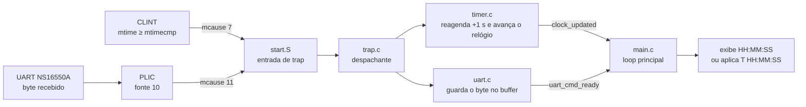

# Relógio Digital Bare-Metal em C para RISC-V 64 bits

**Relógio `HH:MM:SS` que roda sem sistema operacional no QEMU `virt`: o tempo avança só por interrupções do temporizador, e a hora é ajustada por comandos recebidos via interrupção da UART.**

[](https://riscv.org/)
[](#detalhes-técnicos)
[](https://www.qemu.org/docs/master/system/riscv/virt.html)
[](#como-compilar-e-executar)
[](../)

Trabalho 2 da disciplina de Organização de Computadores (UFMT, prof. Linder Cândido da Silva), na versão em C. O programa é *bare metal*: não usa sistema operacional, newlib, libgcc nem qualquer biblioteca externa, e controla os periféricos do QEMU `virt` por registradores mapeados em memória. A versão do mesmo trabalho em Assembly está em [riscv-clock](../riscv-clock).

---

## Sumário

- [Destaques](#destaques)
- [Como funciona](#como-funciona)
- [Funcionalidades](#funcionalidades)
- [Pré-requisitos](#pré-requisitos)
- [Estrutura do projeto](#estrutura-do-projeto)
- [Como compilar e executar](#como-compilar-e-executar)
- [Como ajustar a hora](#como-ajustar-a-hora)
- [Compilação manual, sem os scripts](#compilação-manual-sem-os-scripts)
- [Detalhes técnicos](#detalhes-técnicos)
- [Fluxo de interrupções](#fluxo-de-interrupções)
- [Observações](#observações)

---

## Destaques

- **Contagem só por interrupção:** o CLINT gera uma interrupção por segundo; não há *polling* do contador.
- **Entrada também por interrupção:** a UART NS16550A sinaliza cada byte pelo PLIC, e o comando é montado num buffer.
- **Ajuste de hora** com `T HH:MM:SS` e validação de faixas.
- **Drivers separados** para UART, temporizador (CLINT), controlador de interrupções (PLIC) e despachante de *traps*.
- **Ambiente reproduzível:** toolchain e QEMU dentro de um contêiner Docker, sem instalar nada no host.

## Como funciona



As rotinas de interrupção só atualizam o estado e levantam *flags*; o loop principal reage a elas, imprimindo a hora ou interpretando o comando recebido.

## Funcionalidades

- Exibe a hora continuamente no formato `HH:MM:SS` via UART
- Contagem de tempo baseada **exclusivamente em interrupções de temporizador** (sem polling)
- Recepção de comandos de ajuste de hora via **interrupção de UART**
- Comando de ajuste: `T HH:MM:SS` (ex: `T 14:30:00`)

---

## Pré-requisitos

- [Docker Desktop](https://www.docker.com/products/docker-desktop/) instalado e em execução
- Terminal (Terminal.app, iTerm2, etc.)

> **Testado em macOS com Docker Desktop.** Não é necessário instalar nenhum compilador RISC-V ou QEMU diretamente na máquina host.

---

## Estrutura do projeto

```
relogio-digital/
├── src/
│   ├── start.S      # Startup + entrada de trap (assembly)
│   ├── main.c       # Loop principal, exibição e parse de comando
│   ├── uart.c       # Driver UART NS16550A
│   ├── timer.c      # Driver CLINT + lógica do relógio
│   ├── trap.c       # Despachador geral de interrupções
│   └── plic.c       # Driver PLIC (roteamento de IRQ externo)
├── linker.ld        # Script de ligação
├── Makefile
├── Dockerfile
├── build.sh         # Script para compilar
├── run.sh           # Script para executar no QEMU
├── relatorio.md          # Relatório do trabalho em Markdown
├── relatorio_tecnico.pdf # Relatório técnico detalhado
└── trabalho_2.pdf        # Enunciado do trabalho
```

---

## Como compilar e executar

### Passo 1 — Construir a imagem Docker e compilar

```bash
chmod +x build.sh run.sh
./build.sh
```

Isso irá:
1. Construir a imagem Docker com o toolchain `riscv64-unknown-elf-gcc` e o QEMU
2. Compilar o projeto dentro do container
3. Gerar os arquivos `clock.elf` e `clock.bin`

### Passo 2 — Executar no QEMU

```bash
./run.sh
```

O relógio iniciará exibindo `00:00:00` e incrementará a cada segundo.

### Como sair do QEMU

```
Ctrl+A  →  X
```

---

## Como ajustar a hora

Com o relógio em execução, digite diretamente no terminal:

```
T 14:30:00
```

Pressione **Enter**. O relógio será atualizado imediatamente.

Regras de validação:
- Formato obrigatório: `T HH:MM:SS`
- `HH`: 00–23
- `MM`: 00–59
- `SS`: 00–59

---

## Compilação manual, sem os scripts

```bash
# Construir imagem
docker build -t relogio-riscv .

# Compilar
docker run --rm -v $(pwd):/work relogio-riscv make

# Executar
docker run --rm -it -v $(pwd):/work relogio-riscv \
    qemu-system-riscv64 -machine virt -nographic -bios none -kernel clock.elf

# Limpar artefatos
docker run --rm -v $(pwd):/work relogio-riscv make clean
```

---

## Detalhes técnicos

| Item | Valor |
|---|---|
| Arquitetura | RISC-V 64 bits (`rv64imac_zicsr`) |
| Máquina QEMU | `virt` |
| Endereço de carga | `0x80000000` |
| UART | NS16550A @ `0x10000000` |
| Timer (CLINT) | `0x02000000` — mtime @ `0x200BFF8`, mtimecmp @ `0x2004000` |
| Frequência do timer | 10 MHz → 1 segundo = 10.000.000 ticks |
| PLIC | `0x0C000000` — UART0 = source 10 |
| Tamanho da pilha | 64 KB |
| Toolchain | `riscv64-unknown-elf-gcc` (Ubuntu 22.04) |

---

## Fluxo de interrupções

```
Timer (CLINT mtime >= mtimecmp)
  → IRQ M_TIMER (mcause = 7)
    → timer_interrupt_handler()
      → agenda próxima interrupção (mtimecmp += 10_000_000)
      → incrementa segundos/minutos/horas
      → sinaliza clock_updated

UART recebe byte
  → PLIC source 10 → IRQ M_EXT (mcause = 11)
    → plic_claim() → dispatch → uart_interrupt_handler()
      → armazena byte no buffer
      → se '\r' ou '\n': sinaliza uart_cmd_ready
    → plic_complete()
```

---

## Observações

- Não utiliza sistema operacional, newlib, libgcc ou qualquer biblioteca externa
- A contagem de tempo ocorre exclusivamente por interrupção (não por polling)
- A recepção de caracteres da UART ocorre exclusivamente por interrupção
- O loop principal apenas reage a flags levantadas pelas ISRs

---

[← Organização de Computadores](../) · [Repositório principal](../../)
