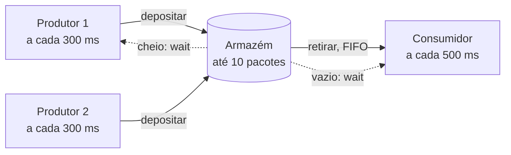

# Armazém: Produtor-Consumidor com monitor

**O problema clássico do produtor-consumidor em Java: produtores e consumidores compartilham um armazém de capacidade limitada, coordenados por um monitor com `synchronized`, `wait()` e `notifyAll()`.**

[](https://openjdk.org/)
[](#como-funciona)
[](../)

Atividade da disciplina de Programação Paralela (UFMT). O armazém é o recurso compartilhado: quem tenta depositar com ele cheio, ou retirar com ele vazio, espera até ser acordado por outra thread.

---

## Sumário

- [Como funciona](#como-funciona)
- [Sobre](#sobre)
- [Como compilar e executar](#como-compilar-e-executar)
- [Estrutura do projeto](#estrutura-do-projeto)

---

## Como funciona



## Sobre

O armazém funciona como um buffer compartilhado com capacidade máxima de **10 pacotes**:

- **Produtores** depositam pacotes a cada 300 ms. Se o armazém estiver cheio, aguardam (`wait()`) até que haja espaço.
- **Consumidores** retiram pacotes a cada 500 ms, em ordem FIFO. Se o armazém estiver vazio, aguardam até que haja pacotes.
- Após cada depósito ou retirada, `notifyAll()` acorda as threads em espera.

A condição de espera é verificada dentro de um laço `while` (e não `if`), garantindo que a thread reavalie o estado após ser acordada, o que a protege contra *spurious wakeups* e contra outra thread ter alterado o armazém antes dela.

Na simulação (`TestArmazem`), são iniciados **2 produtores** e **1 consumidor**. Como a produção é mais rápida que o consumo, o armazém enche em poucos segundos e os produtores passam a aguardar, o que evidencia o funcionamento da sincronização. O programa executa indefinidamente e deve ser encerrado com `Ctrl+C`.

> Cada produtor mantém seu próprio contador, então números de pacote repetidos na saída são esperados (um de cada produtor).

## Como compilar e executar

```bash
javac *.java
java TestArmazem
```

### Exemplo de saída

```
Depositado: pacote 6 | Ocupação: 10/10
Retirado: pacote 2 | Ocupação: 9/10
Depositado: pacote 7 | Ocupação: 10/10
Armazém cheio! Produtor aguardando...
Armazém cheio! Produtor aguardando...
Retirado: pacote 2 | Ocupação: 9/10
```

## Estrutura do projeto

| Arquivo | Descrição |
|---|---|
| `Armazem.java` | Monitor com o buffer compartilhado e os métodos sincronizados `depositar` e `retirar` |
| `Produtor.java` | `Runnable` que deposita pacotes continuamente |
| `Consumidor.java` | `Runnable` que retira pacotes continuamente |
| `TestArmazem.java` | Classe principal que cria o armazém e inicia as threads |

---

[← Programação Paralela](../) · [Repositório principal](../../)
