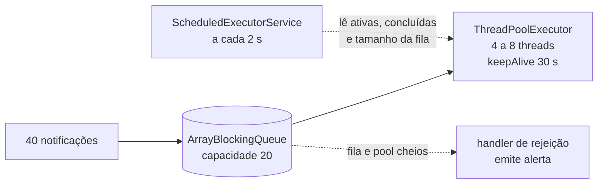

# NotificationSystem: pool de threads com monitoramento

**Simulação de um serviço de notificações em Java que processa 40 tarefas num `ThreadPoolExecutor` com fila limitada e política de rejeição própria, enquanto um `ScheduledExecutorService` publica as métricas do pool.**

[](https://openjdk.org/)
[](#como-funciona)
[](../)

Atividade da disciplina de Programação Paralela (UFMT). O exercício mostra como um pool de threads cresce entre o número mínimo e o máximo de threads conforme a fila enche, o que acontece quando os dois limites são atingidos, e como encerrar os *executors* sem deixar threads vivas.

---

## Sumário

- [Como funciona](#como-funciona)
- [Sobre](#sobre)
- [Como compilar e executar](#como-compilar-e-executar)
- [Estrutura do projeto](#estrutura-do-projeto)

---

## Como funciona



## Sobre

O programa simula o envio de 40 notificações, processadas por um pool de threads configurado com:

- **corePoolSize:** 4
- **maximumPoolSize:** 8
- **keepAliveTime:** 30 segundos
- **Fila de tarefas:** `ArrayBlockingQueue` com capacidade para 20 itens
- **Política de rejeição:** handler customizado que alerta quando o pool e a fila atingem o limite

Paralelamente, um `ScheduledExecutorService` monitora e imprime métricas (threads ativas, tarefas completadas e tamanho da fila) a cada 2 segundos.

Ao final da execução, o sistema aguarda a conclusão de todas as tarefas e encerra os executors de forma controlada, evitando vazamento de threads.

## Como compilar e executar

```bash
javac NotificationSystem.java
java NotificationSystem
```

## Estrutura do projeto

| Arquivo | Descrição |
|---|---|
| `NotificationSystem.java` | Código-fonte do sistema de notificações |

---

[← Programação Paralela](../) · [Repositório principal](../../)
