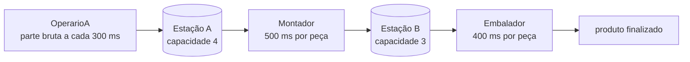

# Linha de montagem com semáforos

**Pipeline de produção em Java com três threads e duas estações de capacidade limitada, sincronizadas por `java.util.concurrent.Semaphore`: um produtor-consumidor encadeado.**

[](https://openjdk.org/)
[](#como-funciona)
[](../)

Atividade da disciplina de Programação Paralela (UFMT). Cada estação é um buffer protegido por três semáforos, e a velocidade diferente de cada etapa deixa visível o gargalo da linha.

---

## Sumário

- [Como funciona](#como-funciona)
- [Sobre](#sobre)
- [Como compilar e executar](#como-compilar-e-executar)
- [Estrutura do projeto](#estrutura-do-projeto)

---

## Como funciona



## Sobre

A linha é composta por três etapas, cada uma executada por uma thread, ligadas por duas estações de trabalho de capacidade limitada:

```
OperarioA --> [ Estação A (cap. 4) ] --> Montador --> [ Estação B (cap. 3) ] --> Embalador
```

- **OperarioA** cria uma parte bruta a cada 300 ms e a deposita na Estação A.
- **Montador** retira uma parte bruta da Estação A, leva 500 ms para montá-la e deposita o componente montado na Estação B.
- **Embalador** retira um componente da Estação B e leva 400 ms para embalá-lo, finalizando o produto.

Cada `EstacaoDeTrabalho` usa três semáforos:

| Semáforo | Permissões iniciais | Função |
|---|---|---|
| `lock` | 1 | Mutex: garante exclusão mútua no acesso à fila |
| `empty` | capacidade | Conta os espaços livres; `depositar` bloqueia quando a estação está cheia |
| `full` | 0 | Conta os itens disponíveis; `retirar` bloqueia quando a estação está vazia |

A ordem das aquisições (`empty`/`full` antes de `lock`) evita deadlock: uma thread nunca aguarda espaço ou item enquanto segura o mutex.

Como o Montador (500 ms) é a etapa mais lenta, ele é o gargalo da linha: a Estação A enche e o OperarioA passa a aguardar, enquanto a Estação B permanece quase sempre vazia. O programa executa indefinidamente e deve ser encerrado com `Ctrl+C`.

## Como compilar e executar

```bash
javac *.java
java TestLinhaMontagem
```

### Exemplo de saída

```
Estação B (Componentes Montados) -> retirado: 8 | Ocupação: 0
Estação A (Partes Brutas) -> depositado: 13 | Ocupação: 4
Produto finalizado: 8
Estação B (Componentes Montados) -> depositado: 9 | Ocupação: 1
Estação A (Partes Brutas) -> retirado: 10 | Ocupação: 3
Estação B (Componentes Montados) -> retirado: 9 | Ocupação: 0
Estação A (Partes Brutas) -> depositado: 14 | Ocupação: 4
Produto finalizado: 9
```

## Estrutura do projeto

| Arquivo | Descrição |
|---|---|
| `EstacaoDeTrabalho.java` | Buffer compartilhado de capacidade limitada, sincronizado com semáforos |
| `OperarioA.java` | `Runnable` que produz partes brutas e as deposita na Estação A |
| `Montador.java` | `Runnable` que transforma partes brutas da Estação A em componentes na Estação B |
| `Embalador.java` | `Runnable` que retira componentes da Estação B e finaliza os produtos |
| `TestLinhaMontagem.java` | Classe principal que cria as estações e inicia as threads |

---

[← Programação Paralela](../) · [Repositório principal](../../)
