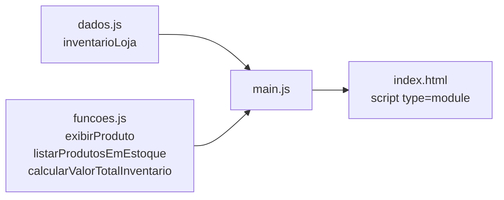

# Gestão de Inventário com módulos ES6

**Sistema de inventário refatorado de um único arquivo para módulos JavaScript com `import` e `export`, separando dados, funções e ponto de entrada.**

[](https://developer.mozilla.org/pt-BR/docs/Web/JavaScript)
[](../../)

Atividade de Programação Web (UFMT). O objetivo é organizar o código por responsabilidade, tornando-o mais fácil de manter e reutilizar.

---

## Estrutura do projeto



| Arquivo | Responsabilidade |
|---|---|
| [`dados.js`](dados.js) | Exporta a lista de produtos da loja |
| [`funcoes.js`](funcoes.js) | Exporta as funções que exibem um produto, listam os itens em estoque e somam o valor total |
| [`main.js`](main.js) | Importa dados e funções e executa o relatório |
| [`index.html`](index.html) | Carrega o `main.js` como módulo |

## Como executar

Navegadores bloqueiam módulos ES6 abertos direto do disco (`file://`). Sirva a pasta com um servidor local e abra o console do navegador:

```bash
python3 -m http.server 8000
# abra http://localhost:8000
```

---

[← Programação Web](../../) · [Repositório principal](../../../)
