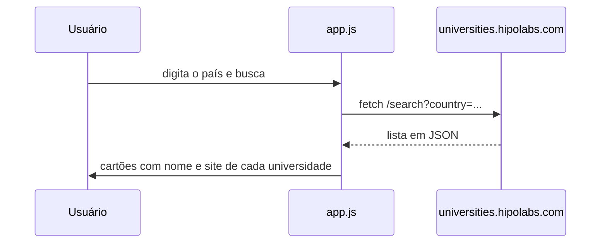

# Requisições assíncronas: busca de universidades por país

**Página que consulta uma API pública com `fetch` e `async`/`await` e mostra as universidades do país digitado, com link para o site de cada uma.**

[](https://developer.mozilla.org/pt-BR/docs/Web/JavaScript)
[-555555)](http://universities.hipolabs.com/)
[](../../)

Atividade de Programação Web (UFMT) para aplicar JavaScript assíncrono a uma API real: a requisição parte de uma entrada do usuário e o resultado é inserido dinamicamente na página.

---

## Como funciona



## Como executar

Abra o [`index.html`](index.html) no navegador, com acesso à internet.

A API responde só em `http://`. Se a página for servida por `https://`, o navegador pode bloquear a requisição por conteúdo misto.

## Estrutura do projeto

```text
requisicoes-assicronas/
├── index.html   # campo de busca e área de resultados
├── app.js       # requisição com fetch e montagem dos resultados
└── style.css    # estilos
```

---

[← Programação Web](../../) · [Repositório principal](../../../)
