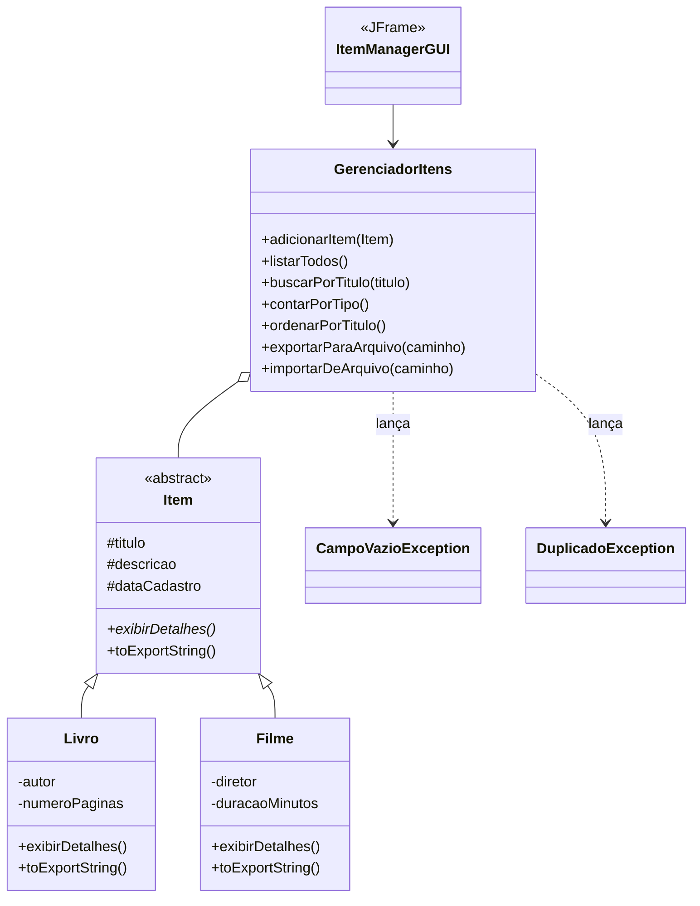

# Sistema de Gerenciamento de Itens: livros e filmes

**Aplicação desktop em Java Swing para cadastrar, listar, filtrar, exportar e importar um acervo de livros e filmes, organizada em camadas e com exceções próprias para as validações.**

[](https://openjdk.org/)
[](#como-executar)
[](#modelo-de-classes)
[](../)

Trabalho final da disciplina de Programação III (UFMT), desenvolvido por **Raissa Cavalcanti** (outubro de 2025). O projeto aplica herança, polimorfismo e encapsulamento num caso completo, separando a interface gráfica da lógica de negócio.

---

## Sumário

- [Destaques](#destaques)
- [Modelo de classes](#modelo-de-classes)
- [Como executar](#como-executar)
- [Uso](#uso)
- [Formato de exportação](#formato-de-exportação)
- [Estrutura do projeto](#estrutura-do-projeto)

---

## Destaques

- **Cadastro de livros** (título, descrição, autor e páginas) **e filmes** (título, descrição, diretor e duração).
- **Busca** por parte do título e **listagem ordenada** por título, com contagem por tipo.
- **Exportação e importação** em texto, com um item por linha.
- **Validações com exceções próprias:** campo obrigatório vazio e título duplicado.
- **Camadas separadas:** modelo, serviço, exceções e interface.

## Modelo de classes



O fluxo de uma operação é: **interface → validação → serviço → modelo**. Erros de validação voltam à interface como exceções e são exibidos ao usuário.

## Como executar

**Pré-requisito:** JDK 8 ou superior.

```bash
cd Trabalho_Final
javac -d out $(find src -name "*.java")
java -cp out gui.ItemManagerGUI
```

## Uso

| Ação | Como fazer |
|---|---|
| Cadastrar | Escolha "Livro" ou "Filme", preencha os campos e clique em **Adicionar** |
| Buscar | Digite parte do título e clique em **Filtrar** |
| Listar | Clique em **Listar Todos**; a contagem por tipo aparece no fim |
| Exportar | Clique em **Exportar Dados** e escolha o arquivo |

## Formato de exportação

```text
Livro|Título|Descrição|2024-01-15|Autor|300
Filme|Título|Descrição|2024-01-15|Diretor|120
```

## Estrutura do projeto

```text
Trabalho_Final/
└── src/
    ├── model/        # Item (abstrata), Livro, Filme
    ├── service/      # GerenciadorItens: cadastro, busca, ordenação, importação e exportação
    ├── exceptions/   # CampoVazioException, DuplicadoException
    └── gui/          # ItemManagerGUI (Swing)
```

---

[← Programação em Java](../) · [Repositório principal](../../)
