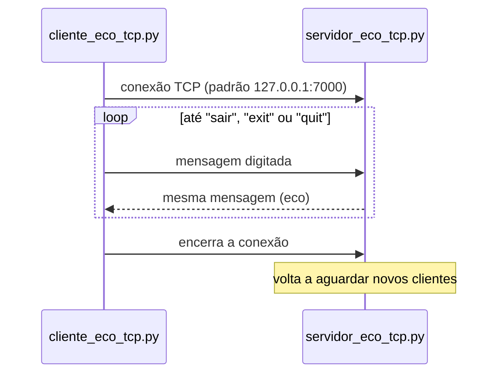

# Redes de Computadores

**Programação com sockets em Python: um cliente do protocolo WHOIS e um par cliente-servidor de eco sobre TCP.**

[](https://www.python.org/)
[](#como-funciona)
[](../)

Atividades da disciplina de Redes de Computadores do curso de Ciência da Computação da UFMT. Os programas usam só a biblioteca padrão (`socket` e `sys`) para mostrar, na prática, a arquitetura cliente-servidor e um protocolo de aplicação real.

---

## Programas

| Arquivo | Descrição |
|---|---|
| [quem.py](quem.py) | Cliente WHOIS: abre uma conexão TCP com `whois.registro.br` na porta 43, envia o domínio e mostra a resposta |
| [servidor_eco_tcp.py](servidor_eco_tcp.py) | Servidor de eco: aceita conexões e devolve cada mensagem recebida até o cliente encerrar |
| [cliente_eco_tcp.py](cliente_eco_tcp.py) | Cliente de eco: envia o que for digitado e mostra o eco do servidor |

## Como funciona



## Como executar

**Pré-requisito:** Python 3, sem dependências externas.

**Consulta WHOIS** (precisa de acesso à internet):

```bash
python3 quem.py ufmt.br
```

**Eco TCP:** inicie o servidor num terminal e o cliente em outro. Host e porta são opcionais.

```bash
python3 servidor_eco_tcp.py [host] [porta]
python3 cliente_eco_tcp.py [host] [porta]
```

```text
Conectado ao servidor 127.0.0.1:7000
Digite uma mensagem ('sair' para encerrar): ola
Eco do servidor: ola
```

O servidor continua aguardando novos clientes até ser interrompido com `Ctrl + C`.

---

[← Repositório principal](../)
